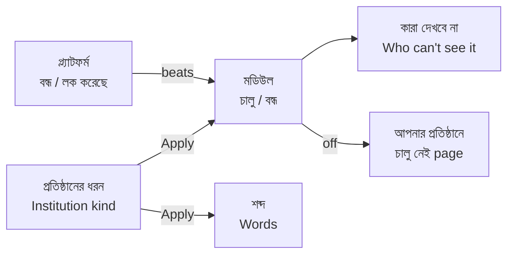

# Epic 77 glossary — Modules & words

Plain words for every screen, button, error and message in Epic 77 (#2450). Source: decision D35. Use the **Say** columns in the app and the guide. Never use the **Never say** column on a screen, in a button, in an error or in a message a school person reads.

## Words

| Say (bn) | Say (en) | Never say | Where it shows |
| --- | --- | --- | --- |
| মডিউল | Module | feature flag, toggle | tab, group lists, palette, guide |
| চালু / বন্ধ | On / Off | enable, disable, flag | switch label next to every module |
| শব্দ | Words | label, override, i18n, key | tab, palette, guide |
| প্রতিষ্ঠানের ধরন | Institution kind | template, preset, profile | kind cards, preview title, `/welcome` step |
| কারা দেখবে না | Who can't see it | role mask, permission | button on each module row, dialog title |
| প্ল্যাটফর্ম বন্ধ করেছে / প্ল্যাটফর্ম লক করেছে | Platform turned it off / Platform locked it | inherited, layer, precedence | source note under a module name |
| আপনার প্রতিষ্ঠানে চালু নেই | This part is not turned on for your institution | 403, forbidden, disabled | page shown when a turned-off module's address is opened |

Source note under each module (D21): **আপনার প্রতিষ্ঠান** (your school decides), **প্ল্যাটফর্ম বন্ধ করেছে** (greyed, off), **প্ল্যাটফর্ম লক করেছে** (greyed, on).

## Button and message sentences

| Where | bn | en |
| --- | --- | --- |
| Kind preview, apply | প্রয়োগ করুন | Apply |
| Kind preview, reassurance (D24) | এটা শুধু দেখা। এখনো কিছু বদলায়নি। | This is only a preview. Nothing has changed yet. |
| Kind preview, what stays | আপনার শিক্ষার্থী, ফি ও অন্য তথ্য, প্ল্যাটফর্মের লক এবং “কারা দেখবে না” বদলাবে না। | Your students, fees and other data, platform locks and "Who can't see it" stay as they are. |
| Switch saved, with undo (D31) | জরিমানা বন্ধ করা হয়েছে · পূর্বাবস্থায় ফেরান | Fines turned off · Undo |
| Switch failed (D32) | সংরক্ষণ হয়নি — আবার চেষ্টা করুন | Not saved — try again |
| Who can't see it, admin note | অ্যাডমিন সবসময় দেখতে পাবেন। | Admins can always see it. |
| Refusal, admin link | চালু করুন | Turn on |
| Refusal, others | অ্যাডমিনকে বলুন | Ask your admin |
| Words tab, example line (D30) | পর্দায় দেখাবে: ৩টি ব্যাচ · 3 Batches | shows as: 3 Batches |

Path on screen (D33): প্রশাসন › সেটিংস › মডিউল ও শব্দ › মডিউল | শব্দ. Title: "মডিউল ও শব্দ · সেটিংস" / "Modules & words · Settings". Preview title: "প্রতিষ্ঠানের ধরন: <নাম>" / "Institution kind: <name>".

**Open:** the bn module and kind names in the mockups (for example জরিমানা, কওমি মাদ্রাসা, কারিগরি) are our drafts. A native Bangla reader has not checked them. The Qawmi kind carries a "যাচাই বাকি" badge, like the Qawmi curriculum pack (D25).
