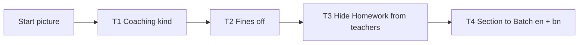

# Epic 77 usability test — Modules & words

Ticket 77.0.02 (#3904), decisions D28–D36 of Epic 77 (#2450). Words in [`77-glossary.md`](77-glossary.md). Mockups in [`77-modules-and-words-mockups/`](77-modules-and-words-mockups/): each screen is `.html` plus `-1440.png` and `-390.png`.

**Status: pending human run.** Nothing below was tested. No result is filled in or guessed. Steps 3–5 of #3904 need 2–3 real admins or office staff, at least one from a coaching centre.

## Screens (start picture per task)

| File | Screen | Used by |
| --- | --- | --- |
| `01-kinds-and-modules` | Settings › Modules & words: 8 kind cards, Modules tab, source notes, failed-save row, undo toast | T1 start, T2 |
| `02-kind-preview` | Preview of a kind (full-page), Apply | T1 next picture |
| `03-who-cant-see-dialog` | "Who can't see it" dialog for Homework | T3 |
| `04-words-tab` | Words tab: table (phone: cards), suggestion, example line | T4 |
| `05-not-turned-on` | Refusal page for admin and for other roles | not a task; shown after T2 to ask "what do you think happened?" |

## How to run

- Hints allowed: none. After 20 seconds of silence say only "আপনি কী খুঁজছেন?".
- The person says what they would press; the facilitator shows the next picture. Start timer when you stop reading the task; stop at the right control or at twice the target (= fail).
- Record first names or P1–P3 only. No phone numbers, no photos (the repo is public).
- Mark a finding if one control takes more than 10 seconds, or the person uses a word not in the glossary.
- Run at least one session on the phone pictures (`-390`).

## Participants

| # | Who | Must be true | Name / date |
| --- | --- | --- | --- |
| P1 | School admin or office staff | runs a real school | _blank_ |
| P2 | Coaching centre admin or staff | runs a real coaching centre | _blank_ |
| P3 (optional) | Office staff | any institution | _blank_ |

## Results

Target is the limit from D36. Pass = done with the right control, unaided, within target.

| Task | Say aloud (bn) | Target | P1 time / help | P2 time / help | P3 time / help | Pass? |
| --- | --- | --- | --- | --- | --- | --- |
| T1 | "আপনার প্রতিষ্ঠান একটি কোচিং সেন্টার। সেভাবে সাজিয়ে নিন।" Success: card → preview → Apply (3 clicks). | 1 min | _blank_ | _blank_ | _blank_ | _blank_ |
| T2 | "জরিমানা বন্ধ করুন।" Success: Fines switch turned off. | 30 s | _blank_ | _blank_ | _blank_ | _blank_ |
| T3 | "শিক্ষকরা যেন হোমওয়ার্ক না দেখেন।" Success: opens "কারা দেখবে না", ticks শিক্ষক, saves. | 1 min | _blank_ | _blank_ | _blank_ | _blank_ |
| T4 | "শাখা-র জায়গায় ইংরেজিতে ও বাংলায় ‘ব্যাচ’ দেখান।" Success: Section → Batch and শাখা → ব্যাচ in both fields, saves. | 1 min | _blank_ | _blank_ | _blank_ | _blank_ |

After each task ask: "নিজের ভাষায় বলুন, এই বোতাম কী করে?" and "এরপর কী হবে বলে মনে করেন?" Note answers below.

## Changes made to the mockups after the test

| # | Screen | Change | Why (task, person) |
| --- | --- | --- | --- |
| _none yet_ | | | |

## Words people used that are not in the glossary

_blank_

## Gate

W4 screen tickets wait until every task passes unaided within target. Each W4 ticket names the task its built screen must pass (D36). After the pass, attach the final 1440 px and 390 px screenshots to #3904 (step 5).

## Notes for whoever runs it

- The module names, the kind blurbs and the bn wording are drafts; changing them is fine if people stumble. Record the change above and in the glossary.
- The mockups use a switch (`role="switch"`) that the kit in `.claude/skills/redesign-page/` does not list. The W4 screen ticket must reuse the real `ui` switch if one exists, or add it to the kit first.
