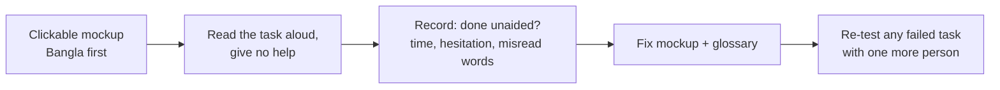

# Reports usability test (Epic 8.15, ticket 8.15.51)

**Status: protocol written, sessions not yet run.** The sessions need real school staff, so a person must run them. Until they have, the report screens in later waves are built from the design in [40-reporting-engine.md](../architecture/40-reporting-engine.md), and any wording or layout fix from the sessions is a follow-up to the screen tickets.

## Who

- 2–3 people who do office work in a pilot or demo school: an admin, an accountant, a vice principal. Not developers.
- 1–2 guardians for task 7, on their own phones.

## How

Mockups: desktop 1440 px and phone 390 px, built from the real design tokens. Screens: the Excel button on the dues list, hub, runner (auto-run and summary line), print, keep-as-report dialog on the students list, designer start, designer editor, staff statement section, guardian statement on a phone, "email this regularly" and "keep today's copy" dialogs.

## Tasks (no help given)

| #   | Task                                                                  | Target (unaided) |
| --- | --------------------------------------------------------------------- | ---------------- |
| 1   | Print the class 6 student list                                        | under 2 minutes  |
| 2   | See how many students there are by class and gender                   | under 2 minutes  |
| 3   | Filter the dues list to class 8 and keep it as a report               | under 2 minutes  |
| 4   | Make "dues by class with guardian phone" from a ready report          | under 3 minutes  |
| 5   | Make "boys and girls per section in class 9" from a question          | under 3 minutes  |
| 6   | Download the class 7 dues list to Excel                               | under 1 minute   |
| 7   | As a guardian, find how much you still owe and download the statement | under 1 minute   |
| 8   | Send the defaulters report to the accountant every month by email     | under 2 minutes  |

## Results

Fill one row per task per participant.

| Task | Participant | Role | Done unaided | Time | Where they hesitated | Words misread |
| ---- | ----------- | ---- | ------------ | ---- | -------------------- | ------------- |
| —    | —           | —    | —            | —    | —                    | —             |

## Done when

- Every task passes unaided with at least two participants on the final mockups.
- [8.15-reports-glossary.md](8.15-reports-glossary.md) lists every word that failed and its replacement.
- A findings summary is posted on #378, and the final mockups are linked from the screen tickets (#3141, #3142, #3098, #3107–#3111, #3119, #3120, #3122, #3123, #3128, #3138).
