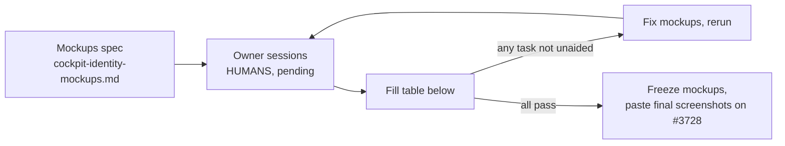

# Cockpit identity: usability findings

**Status: PENDING OWNER SESSIONS. No test has been run. No tester, time or result below is real.**

This file is the shell for #3728 step 3 and step 5. An agent built the mockup spec and this table. The two owners and one trusted non-technical person must run the five tasks on the mockups. Nothing here counts toward the acceptance criteria until they do.

## Targets

All tasks unaided. Known-device sign-in under 30 s. First set-up under 5 min. Lock under 20 s.

## Results

Testers: **Owner A**, **Owner B**, **Trusted person** (tasks 1 and 5 only).

| # | Task | Tester | Result (unaided / helped / failed) | Time | Target | Pass |
|---|---|---|---|---|---|---|
| 1 | First sign-in from my phone | Owner A | pending owner sessions | pending | 30 s (known device) | pending |
| 1 | First sign-in from my phone | Owner B | pending owner sessions | pending | 30 s (known device) | pending |
| 1 | First sign-in from my phone | Trusted person | pending owner sessions | pending | 30 s (known device) | pending |
| 2 | Phone lost: sign in with a recovery code | Owner A | pending owner sessions | pending | unaided only | pending |
| 2 | Phone lost: sign in with a recovery code | Owner B | pending owner sessions | pending | unaided only | pending |
| 3 | Other owner looks hacked: lock them | Owner A | pending owner sessions | pending | 20 s | pending |
| 3 | Other owner looks hacked: lock them | Owner B | pending owner sessions | pending | 20 s | pending |
| 4 | Approve the other owner's request | Owner A | pending owner sessions | pending | unaided only | pending |
| 4 | Approve the other owner's request | Owner B | pending owner sessions | pending | unaided only | pending |
| 5 | Add the authenticator on a new phone | Owner A | pending owner sessions | pending | 5 min (first set-up) | pending |
| 5 | Add the authenticator on a new phone | Owner B | pending owner sessions | pending | 5 min (first set-up) | pending |
| 5 | Add the authenticator on a new phone | Trusted person | pending owner sessions | pending | 5 min (first set-up) | pending |

## What went wrong in each run

One row per stumble. Leave empty until sessions are run.

| Task | Tester | What they said | Where they stopped | Mockup fix |
|---|---|---|---|---|
| pending owner sessions | | | | |

## Words that changed

See `cockpit-identity-glossary.md`, "Words changed by testing". Pending.
