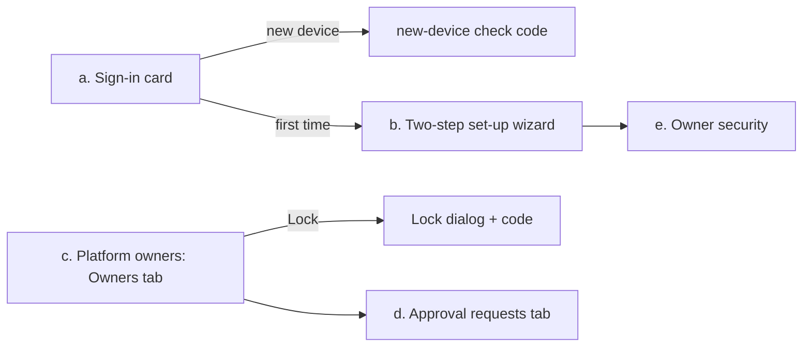

# Cockpit identity: mockups (spec and wireframes)

Epic 98 (#3725), ticket #3728. Five screens, built from the app kit and tokens (`docs/architecture/21-ui-patterns.md` §3, §4, §12). Words come from `cockpit-identity-glossary.md`.

**Status: wireframe spec, NOT frozen.** Clickable kit-built HTML mockups and the 1440 px / 390 px screenshots are not in this file yet (see "Still to do"). Nothing here has been usability-tested.



## a. Sign-in card (`/sign-in`, `AuthLayout` card)

One step per screen. Focus moves to the first field of each new step. Enter submits.

```
+--------------------------------+
|  Cockpit                       |
|  Password        [**********]  |
|                  [ Next  ]     |
+--------------------------------+
        | Enter
+--------------------------------+
|  Authenticator code (6 digits) |
|  [ _ ][ _ ][ _ ][ _ ][ _ ][ _ ]|   <- CodeField
|  Lost your phone? Recovery code|
|                  [ Sign in ]   |
+--------------------------------+
        | only on a new device
+--------------------------------+
|  New-device check              |
|  Code sent by SMS and email    |
|  [ _ ][ _ ][ _ ][ _ ][ _ ][ _ ]|
+--------------------------------+
```

Known device: password + 6-digit code only (target 30 s). Wrong code text: under the field, per glossary.

## b. Two-step set-up wizard (`/owner-security/two-step`, `FullPageShell` + `WizardShell`)

```
Desktop 1440                          Phone 390
Step 1 of 2  Add authenticator        Step 1 of 2
+--------+  1. Scan this QR           [ Open authenticator app ]  <- otpauth button
|  QR    |  2. Enter the 6-digit      [ Copy key ]
+--------+     code  [ CodeField ]     [ CodeField ]
                                      [ Next ] (44 px)
Step 2 of 2  Save recovery codes
 RecoveryCodesCard: 10 one-time codes, [Copy] [Download], tick "I saved them" -> Finish
```

Target: first set-up under 5 min. On phone the QR is replaced by the `otpauth` button and Copy key.

## c. Platform owners, Owners tab, Lock dialog (`/platform-owners?tab=owners`)

```
Cockpit > Platform owners            [Owners | Approval requests | History]
+----------------------------------------------------------+
| Owner B   active   last sign-in 2h ago   [ Lock ]        |
| Owner A   (you)    active                [ Lock ] off    |
+----------------------------------------------------------+
Lock dialog (Dialog sm): "Lock Owner B?"  [CodeField: confirm with a code]
                         [Cancel] [Lock]
```

Lock in two taps: card, Lock, confirm, code. Target 20 s. Last active owner: Lock disabled plus a small note. Phone: owners as cards, 44 px buttons, `_platform` bottom bar. Ctrl+K "Lock" opens the same dialog.

## d. Approval requests tab (`?tab=approvals`)

```
+----------------------------------------------------------+
| Owner B asks: <action>   14:02   [ Reject ] [ Approve ]  |
+----------------------------------------------------------+
Empty: "No request is waiting."
Approve opens the confirm-with-a-code dialog (same CodeField).
```

Approvals are single-use, bound to actor, scope and payload (epic invariant).

## e. Owner security (`/owner-security`, page with cards, `_staff/security.tsx` shape)

```
Cockpit > Security
+ Two-step sign-in ------------------+   [ New recovery codes ]
| Authenticator: on   [ Replace ]    |
+ Signed-in devices ----(SessionList)+
| This phone  now   [ Sign out ]     |
```

Reuses `SessionList`, `AuthenticatorSetupCard`, `RecoveryCodesCard`.

## Kit check

| Piece | Source | Status |
|---|---|---|
| `CodeField` | new, #3729 | kit gap, shared-component ticket first |
| `RecoveryCodesCard` | new, #3729 | kit gap |
| `AuthenticatorSetupCard` | new, #3729 | kit gap |
| `AuthLayout`, `FullPageShell`, `WizardShell`, `Dialog`, `SessionList`, `ListShell` | existing | reuse |

## Still to do (not done by this lane)

- Clickable HTML mockups and 1440 / 390 screenshots: HTML and PNG files fall outside this lane's territory (`docs/ux-research/cockpit-identity-*.md`), so none were committed. Owner or orchestrator decides the folder.
- Owner sessions, fix loop, freeze: see `cockpit-identity-findings.md`.
