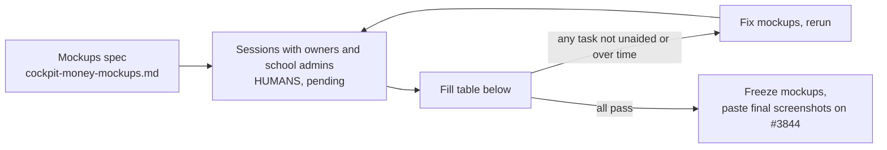

# Cockpit money: usability findings

**Status: PENDING HUMAN PARTICIPANTS. No test has been run. No tester, time or result below is real.**

This file is the shell for #3844 step 4 and step 5. An agent wrote the mockup spec, the glossary and this table. Two platform owners and two real school admins must run the five tasks (D17) on clickable mockups, unaided. The maintainer recruits the school admins first. Nothing here counts toward the acceptance criteria until they do, so #3844 stays open.

## The five tasks and targets (D17)

| # | Who | Task | Target |
|---|---|---|---|
| a | Owner | Read the SMS state and say what to do | 30 s |
| b | Owner | Make a 5,000-SMS package | 2 min |
| c | Owner | Make a 50% coupon for 2 schools | 2 min |
| d | School admin | Buy an SMS package | 1 min |
| e | School admin | Buy 50 seats for 3 months with a coupon | 2 min |

All tasks unaided. Time each run.

## Results

Testers: **Owner A**, **Owner B**, **School admin 1**, **School admin 2**.

| # | Tester | Result (unaided / helped / failed) | Time | Target | Pass |
|---|---|---|---|---|---|
| a | Owner A | pending human participants | pending | 30 s | pending |
| a | Owner B | pending human participants | pending | 30 s | pending |
| b | Owner A | pending human participants | pending | 2 min | pending |
| b | Owner B | pending human participants | pending | 2 min | pending |
| c | Owner A | pending human participants | pending | 2 min | pending |
| c | Owner B | pending human participants | pending | 2 min | pending |
| d | School admin 1 | pending human participants | pending | 1 min | pending |
| d | School admin 2 | pending human participants | pending | 1 min | pending |
| e | School admin 1 | pending human participants | pending | 2 min | pending |
| e | School admin 2 | pending human participants | pending | 2 min | pending |

## What went wrong in each run

One row per stumble. Leave empty until sessions are run.

| Task | Tester | What they said | Where they stopped | Mockup fix |
|---|---|---|---|---|
| pending human participants | | | | |
