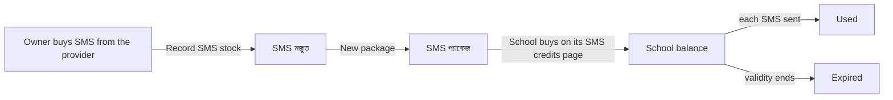

# Cockpit money glossary

Plain words for every money screen, button and error in Epic 100 (#3727). Use the **UI** column on screen. Never use the **Never say** column on a screen, a button, an error or a message.

Source: epic #3727, decision D15 (final). The last column records whether a real person understood the word. It stays **pending** until the sessions in `cockpit-money-findings.md` are run.

| UI (bn) | English | Never say | Word test |
|---|---|---|---|
| SMS প্যাকেজ | SMS package | bundle | pending sessions |
| SMS মজুত | SMS stock (what the owner bought from the provider) | stock, lot, ledger, allocation | pending sessions |
| কুপন | coupon | voucher, promo code | pending sessions |
| ফেরত | refund | reversal, chargeback | pending sessions |
| ভ্যাট | VAT | tax rate, levy | pending sessions |
| প্ল্যান | plan (the per-seat price a school pays) | tier, pricing profile | pending sessions |
| টাকা-পয়সা | Money (cockpit nav item) | billing console, finance | pending sessions |
| আনমাস্কড SMS | unmasked SMS | non-masking, raw sender | pending sessions |
| মেয়াদ | validity / expiry | TTL, lot expiry | pending sessions |

**Unmasked, in one plain sentence (shown under the school SMS credits balance):** "Your SMS goes out with a plain phone number as the sender, not your school's name."

Example of the rule: the owner's button says "নতুন SMS প্যাকেজ" (New SMS package). It never says "Create bundle".

## Messages fixed by the epic

| Moment | English meaning | Rule |
|---|---|---|
| Any coupon fails | One sentence, the same for every failure | Never hints at other schools' coupons (D23). |
| Too many wrong coupon tries | "Too many tries, wait a little and try again." | 10 per 15 minutes per school. |
| Free by coupon | Receipt says "free by coupon" | 100% skips bKash; it is still a sale (D24). |
| SMS almost finished | RED notice, links to the buy page | School admin only (D19, D20). |
| SMS at zero | "SMS stopped", same red notice | D20. |

## Words changed by testing

None yet. After the sessions, add one row per word a tester misread: old word, new word, who, what they said.
