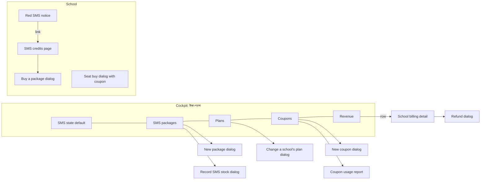

# Cockpit money: mockups (spec and wireframes)

Epic 100 (#3727), ticket #3844. Built from the app kit and tokens (`docs/architecture/21-ui-patterns.md`, `15-ux-principles.md`). Words come from `cockpit-money-glossary.md` (D15): on-screen text below uses only Say-column words. Headings are cited by name by the Wave 4 and 5 screen tickets: do not rename them.

**Status: wireframe spec, NOT frozen.** Clickable kit-built HTML mockups and the 1440 px / 390 px screenshots are not in this file yet (see "Still to do"). Nothing here has been usability-tested.



Cockpit shell: Epic 98 (#3765). One nav item "টাকা-পয়সা", tabs `SMS state` (default) · `SMS packages` · `Plans` · `Coupons` · `Revenue` (D13). Breadcrumb `Cockpit › টাকা-পয়সা › tab`.

## Money - SMS state (phone)

Phone first (D12, D14). "What to do" lines first, then numbers, then schools as cards. No filter first.

```
390 px
+------------------------------+
| টাকা-পয়সা                    |
| SMS state                    |
+------------------------------+
| What to do                   |
| - 3 schools have under 100   |
|   SMS left. [See schools]    |
| - SMS মজুত is low: 4,200     |
|   left. [SMS মজুত লিখুন]   |
| - 12,000 SMS expire in 7 days|
+------------------------------+
| Bought 100,000   Sold 62,000 |
| Used 41,000   Expired 3,000  |
| Revenue Tk 31,000 Cost 18,000|
| Margin Tk 13,000             |
+------------------------------+
| [card] Green Valley School   |
|   left 60 · used 940 · red   |
| [card] Sunrise Academy       |
|   left 5,100 · fine          |
+------------------------------+
```

Example: the owner reads line 1, taps "See schools", and knows who to call. Target 30 s (task a).

## Money - SMS state (desktop)

Same three parts in one column, 1440 px: "What to do" strip on top, a six-tile number row, then a table of schools (school, bought, used, left, expiring, failure rate) with CSV export. Failure rate is a column only (D18).

```
+-----------------------------------------------------------+
| What to do: 3 lines                         [Export CSV]  |
+-----------------------------------------------------------+
| Bought | Sold | Used | Expired | Revenue | Cost | Margin   |
+-----------------------------------------------------------+
| School          Bought  Used  Left  Expires   Failed %     |
| Green Valley    5,000   4,940   60  7 days    1.2%        |
+-----------------------------------------------------------+
```

## Money - SMS packages

List of SMS প্যাকেজ (cards on phone, `ListShell` table on desktop): name, SMS count, price, validity, on/off. Button "নতুন SMS প্যাকেজ" and button "SMS মজুত লিখুন". Packages are switched off, never deleted.

```
[ নতুন SMS প্যাকেজ ]   [ SMS মজুত লিখুন ]
5,000 SMS · Tk 1,500 · valid 180 days   [on]
1,000 SMS · Tk 350   · valid 90 days    [on]
```

## New package dialog

`Dialog` sm. Limits (D22): SMS 100 to 1,000,000; validity 1 to 365 days; price with 2 decimals within the money cap.

```
New SMS package
Name        [ 5,000 SMS            ]
SMS         [ 5000 ]   Validity (days) [ 180 ]
Price (Tk)  [ 1500.00 ]
            [Cancel] [Save]
```

Task b: make a 5,000-SMS package in 2 min.

## Record SMS stock dialog

What the owner bought from the provider (D11): date, SMS count, cost, note.

```
SMS মজুত লিখুন
Date [ today ]  SMS [ 100000 ]  Cost (Tk) [ 18000.00 ]
Note [ optional ]            [Cancel] [Save]
```

## Money - Plans

Plans are what a school pays per seat per month (default Tk 10). List: plan, price, schools on it, on/off. The default plan cannot be switched off (D26). Plans are switched off, never deleted.

## Change a school's plan dialog

Opened from the school's billing detail. Affects the next order only (D26).

```
Change plan for Green Valley School
Plan [ Default Tk 10 v ]   Reason [ required ]
"This changes the price of the next order only."
                           [Cancel] [Change]
```

## Money - Coupons

List: code, discount, first N months, uses, expiry, on/off. Button "New coupon". Row opens Coupon usage report.

## New coupon dialog

```
New coupon
Code [ SPRING50 ]   (4 to 20: A-Z, 0-9, -)
Discount [ 50 % v ]   First [ 3 ] months
Max discount (Tk) [ optional ]   Minimum order (Tk) [ optional ]
Valid until [ date ]   Schools [ Green Valley x ] [ Sunrise x ]
                      [Cancel] [Save]
```

100% case (D24): choosing 100 shows "A free coupon needs the other owner to approve." The button becomes "Ask the other owner", then a confirm-with-a-code step. With no second owner available it cannot be created (D29). Task c: 50% coupon for 2 schools in 2 min.

## Coupon usage report

Per coupon: uses, schools, total discount in Tk, orders list. Cancel or refund never returns a use (D25).

## Money - Revenue

Monthly income with seats and SMS packages apart, paying schools, schools whose seats ended and did not renew (D10). CSV export. No dues reminders.

## School billing detail

Cockpit page for one school: current plan (link to the plan dialog), orders list (date, kind, amount, VAT, status), a "Refund" button per paid order, and the VAT line on each receipt.

```
Green Valley School   Plan: Default Tk 10   [Change plan]
Order        Date    Amount   VAT    Status   
SMS 5,000    12 Nov  1,500    195    Paid     [Refund]
50 seats x3  02 Nov  1,500    195    Paid     [Refund]
```

## Refund dialog

Reason, then confirm-with-a-code (step-up). Plain instruction because the refund is done by hand in bKash.

```
Refund Tk 1,500?
Reason [ required ]
"After you save, send the money back from the bKash panel. Use this reference: ABC123."
Confirm with a code [ _ _ _ _ _ _ ]
                         [Cancel] [Refund]
```

## VAT setting dialog

One setting for the whole platform, moved from the environment value (D27).

```
VAT setting
VAT (%) [ 13 ]   Reason [ required ]   [Cancel] [Save]
```

## School - SMS credits page

Existing page, new parts added. Balance, packages with expiry, the unmasked note, the switch, history.

```
SMS credits                    Balance 4,940 SMS
"Your SMS goes out with a plain phone number as the sender, not your school's name."
Switch to SchoolManagerP SMS: [ off ]
Packages
[5,000 SMS · Tk 1,500 · valid 180 days   [Buy]]
[1,000 SMS · Tk 350   · valid 90 days    [Buy]]
Your packages: 3,000 left, ends 30 Apr · 1,940 left, ends 30 Jun
History: date, kind (bought / used / expired), SMS
```

For now SchoolManagerP sends only unmasked SMS, stated in the note. Phone: packages stack as full-width cards, 44 px Buy button.

## School - Buy a package dialog

One card per package, Buy, straight to bKash (D12). One package per order, no cart.

```
Buy 5,000 SMS
Tk 1,500 + VAT Tk 195 = Tk 1,695   valid 180 days
[Cancel] [Buy with bKash]
```

Task d: buy a package in 1 min.

## School - Seat buy dialog with coupon

Existing Seats and billing dialog. The coupon is a collapsed row (D12).

```
Buy seats: [ 50 ] seats for [ 3 ] months
> Have a coupon?            (collapsed)
  [ SPRING50 ] [Apply]
Price: 50 x Tk 10 x 3 = Tk 1,500
Coupon -50%: -Tk 750     Total Tk 750
```

Free by coupon (100%): total Tk 0, the button reads "Get seats" and skips bKash, the receipt says "free by coupon". One-sentence failure, the same for every failure: "This coupon cannot be used." Too many tries: "Too many tries, wait a little and try again." Task e: 50 seats x 3 months with a coupon in 2 min.

## School - Red SMS notice

School admin only (D19, D20). Attention bar, critical (red), under the top bar on every page. Shown at 100 SMS or fewer, or under 10% of active packages, whichever is more; at zero it reads "SMS stopped".

```
[!] Your SMS is almost finished: 60 left.   [Buy SMS package]
```

Expiry notices (D21): amber at 7 days, red at 1 day, same link, none at 0 left. The notice clears after a purchase.

## Kit check

| Piece | Source | Status |
|---|---|---|
| `Dialog`, `ListShell`, `StatTile`, attention bar, `Badge`, `ConfirmDialog` | `@biddaloy/ui` | reuse |
| Confirm-with-a-code field | Epic 98 `CodeField` (#3729) | reuse once it ships |
| Collapsed "Have a coupon?" row | `Collapsible` | reuse, confirm in Wave 4 |
| Cockpit shell, nav, `_platform` bottom bar | Epic 98 (#3765) | reuse |

## Still to do (not done by this lane)

- Clickable HTML mockups and 1440 / 390 screenshots for every heading above: HTML and PNG files fall outside this lane's territory (`docs/ux-research/cockpit-money-*.md`), so none were committed. Owner or orchestrator decides the folder.
- Sessions with two owners and two real school admins, fix loop, freeze: see `cockpit-money-findings.md`. **Needs human participants.**
