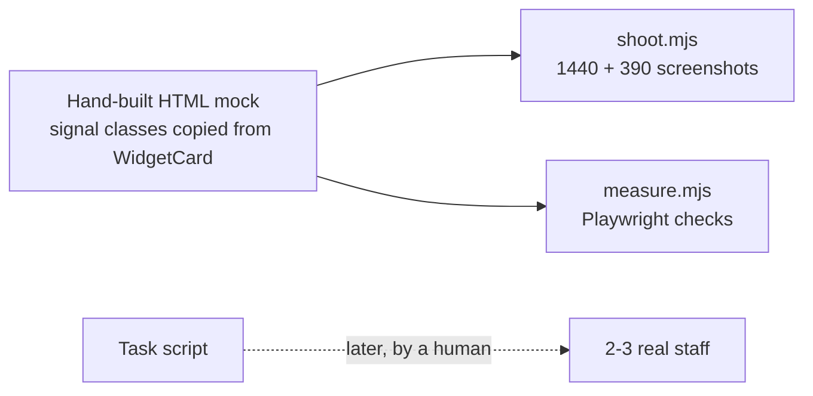

# Dashboard signal: findings

> **AI-simulated: run by automated agent, NOT real users. Does not satisfy real-user acceptance criterion #3596.**
> No staff took part. No timings from people exist. Nothing below is user evidence.

## What was done

Files, all under `docs/ux-research/`:

- `dashboard-signal/mockup.html`, `desktop.png` (1440px), `mobile.png` (390px)
- `dashboard-signal/measure.mjs` (objective checks)
- `dashboard-signal-task-script.md` (3 tasks for a human to run)

## Method and honest limits

- The mock is plain HTML. It copies the markup and classes of `WidgetCard` and `signal.ts` (icon, `data-signal`, sr-only label, left bar, critical band). It does not render the real React component or a Storybook story.
- It uses the real stylesheet and signal colour tokens. Sample data only, 12 ADMIN-style cards: 2 critical, 3 watch, 7 ok. Signal labels are real keys from `bn/signal.json`.
- Card titles are real `bn/dashboard.json` titles. The values and summaries are invented for the mock.
- Sidebar and bottom bar come from the redesign-page starter. The active item reads "শিক্ষার্থী", not "ড্যাশবোর্ড". Context only, not fixed.

## Measured (Playwright, `measure.mjs`)

| Check | Desktop 1440 | Phone 390 |
|---|---|---|
| Cards: critical / watch / ok | 2 / 3 / 7 | 2 / 3 / 7 |
| Markers with aria-hidden icon AND sr-only text | 12 of 12 | 12 of 12 |
| Lowest signal-text contrast vs card background | 6.15:1 | 6.15:1 |
| Critical cards fully above the fold | 2 of 2 | 2 of 2 |
| Sideways scroll, missing labels, small tap targets, page errors (`shoot.mjs`) | none | none |

Contrast is signal text on the plain card colour. The red band behind critical titles was not measured. Light theme only.

## Not measured

- Any human time to answer "what needs me now?". Target is under 5 s. Unknown.
- Whether staff understand the Bangla words.
- Screen reader behaviour in a real reader. Only the DOM text was checked.
- Dark theme, colour-blind simulation.

## Glossary changes

None found. This was not tested with people, so "none found" means "none tested", not "terms are fine".

## Open items (need real users)

- [ ] Run the task script with 2 to 3 real staff, record seconds and quotes.
- [ ] Confirm the five signal words in `signal.json` are understood.
- [ ] Redo the mock if any task fails. Then re-shoot.
- [ ] Measure band contrast and dark theme.
