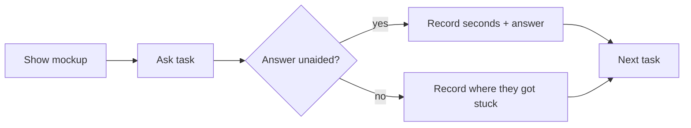

# Dashboard signal: task script for real staff

> **AI-simulated: run by automated agent, NOT real users. Does not satisfy real-user acceptance criterion #3596.**
> This script is only prepared. No person has used it yet. A human runs it later with 2 to 3 real staff (a head or principal, plus an office user). Not developers.

## Before you start

- Show `dashboard-signal/desktop.png` (office user) or `dashboard-signal/mobile.png` (head, on phone). Sample data only.
- Say: "Please tell me what you see. I am testing the screen, not you."
- Start a timer when the page appears. Stop at the first answer. Do not hint.
- Write down: the answer, the seconds, any help given, any word they did not understand.

## Tasks

| # | Ask in staff words (Bangla first) | English | Expected answer on this mockup | Target |
|---|---|---|---|---|
| 1 | "এখন কোন কার্ডগুলোতে আমার নজর দেওয়া দরকার?" | Which cards need me right now? | Two: "আপনার অনুমোদনের অপেক্ষায়" and "এ মাসের আদায়" (red, warning icon). Optionally the three "নজর রাখুন" cards as "watch". | Unaided, under 5 s |
| 2 | "এ মাসে টাকা আদায় কি ঠিকমতো চলছে?" | Is money collection on track this month? | No. 42%, 28 points behind target. Card is red, "পিছিয়ে আছে". | Unaided, under 5 s |
| 3 | "আজ স্টাফের উপস্থিতিতে কোনো সমস্যা আছে?" | Is anything wrong with staff attendance today? | Yes, a little. 22 of 26 present, 4 have not marked yet. Card is amber, "নজর রাখুন". Not red. | Unaided, under 5 s |

## After the tasks

Ask each person, in Bangla:

1. "কোন শব্দটা বুঝতে অসুবিধা হয়েছে?" (Which word was unclear?)
2. "লাল আর হলুদ ছাড়া অন্য কিছু দেখে কি বুঝতে পারতেন?" (Would you know without colour? Tests icon and text.)
3. Phone only: "কোন কার্ড খুলতে হয়েছে?" (Which card did you have to open?)

Glossary terms under test: এখনই দেখা দরকার, নজর রাখুন, সব ঠিক আছে, পিছিয়ে আছে, কমে এসেছে. Record any term that needs a change.

## Pass rule (from #3596)

Task done unaided, and "what needs me now?" answered in under 5 seconds, by every participant. If not, change the mockup and re-run.
