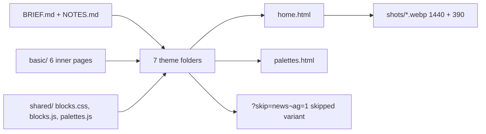

# Epic 40 — public school website: reviewed mockups

These are the pictures the W4 tickets #3639 (40.4.01)–#3644 (40.4.06) build from.
They are plain HTML + CSS (a little JS), no framework, no real photos (D17). Open any file in a browser.

## Reshoot (under 10 lines)

```bash
yarn install                # once, gives you playwright
npx playwright install chromium   # once
brew install webp           # once, gives you cwebp (shots are WebP; Debian/Ubuntu: apt install webp)
node docs/ux-research/epic-40-public-website/site/shoot.mjs                      # every page + variant -> site/shots/
node docs/ux-research/epic-40-public-website/site/shoot.mjs basic/home.html shots/basic-home   # one page
node docs/ux-research/epic-40-public-website/site/contrast.mjs                   # WCAG AA check of every palette, exit 1 on a fail
```

Every shot prints `horizontal-overflow=<n>px`; at 390 px it must be `0px`. The full run exits 1 if any 390 shot overflows
or a page throws a JS error. Shots are WebP at quality 80: the first PNG set was 26 MB, and git keeps every committed
image forever.

## What is in `site/`



| Theme folder | Demo school (from BRIEF.md) | Default language |
|---|---|---|
| `primary/` | সূর্যমুখী শিশু বিদ্যালয় / Surjomukhi Children's School, Dhanmondi | bn |
| `high-school/` | রামপুরা মডেল উচ্চ বিদ্যালয় / Rampura Model High School, est. 1968 | bn |
| `college/` | স্বপ্নপুর কলেজ / Shopnopur College, est. 1994 | bn |
| `madrasa/` | জামিয়া দারুল উলূম মাদ্রাসা / Jamia Darul Uloom Madrasa | bn |
| `international/` | Dreamhill International School | en |
| `premium/` | কল্পনগর গ্রামার স্কুল / Kalponagar Grammar School, est. 1961 (made-up town) | bn |
| `basic/` | নবীনগর উচ্চ বিদ্যালয় / Nabinagar High School (the default theme, 7 pages) | bn |

Extra files per theme: `palettes.html` (three palettes, D28). `basic/` and `college/` also have `home-reordered.html` (D31).
`basic/` is built by `python3 basic/build.py` (Python 3.9+, stdlib only) from one shell; edit `build.py`, not the
generated pages. The same script writes every `data-field` key: `python3 basic/build.py --key <theme>/home.html`
re-keys a theme page after an edit, and `python3 basic/build.py --check` asserts the shared keys (see NOTES, D25).
Links and buttons get a fixed key whatever their label says, the same in all seven themes:

| Element                                   | Key                                                     |
| ----------------------------------------- | ------------------------------------------------------- |
| main menu link                            | `header.nav.home` … `header.nav.contact`                |
| first / second hero button                | `hero.cta_primary` / `hero.cta_secondary`               |
| "all notices" / calendar / blog links     | `notices.see_all` / `events.see_all_calendar` / `blog.see_all` |
| WhatsApp / show-map buttons               | `contact.whatsapp` / `contact.map`                      |
| footer column 1 title, footer links       | `footer.school_name`, `footer.links.<role>`             |

`--check` fails on a missing key, a link or button keyed by its label, or a page whose keys are stale.
Full list in `site/NOTES.md` (D25).

Query switches on any `home.html` (used by `shoot.mjs`, handy in a browser too):
`?photos=1` one hero photo only · `?palette=1|2` apply an alternate palette · `?skip=news&notag=1` remove one whole section and the tagline · `?marquee=1` announcement bar with one item (a static line).

## Which decision each artefact shows

| Decision | Where to look |
|---|---|
| D3 footer credit "Powered by SchoolManagerP" | footer of every `home.html` |
| D7 / D13 one theme system, phone first | every `*-home-390.webp`, zero horizontal overflow |
| D17 no children, no student photos | every photo slot is an illustration or a labelled frame |
| D19 every image slot says its exact size | `1920 × 1080`, `400 × 400`, `1200 × 630` labels |
| D24 sample themes reviewed before tickets | the seven `home.html` |
| D25 editable defaults | `data-field="<section>.<field>"` on every text, `*-home-skipped-*.webp` |
| D26 hero carousel | 3 slides, dots, arrows, swipe, 6 s auto-advance; `basic-home-onephoto-*.webp` |
| D27 teachers capped at 8 + "সবাইকে দেখুন" | teachers section of every `home.html`; full list in `basic/teachers.html` |
| D28 palette variants | `<theme>/palettes.html`, hex sets in `site/NOTES.md`, `contrast.mjs` |
| D30 announcement bar | marquee above the hero in every `home.html`; `?marquee=1` for the one-item line |
| D31 section order is free | `basic/home-reordered.html`, `college/home-reordered.html` |

## Notes for the W4 builders

- `site/NOTES.md` has the one idea, palette, type pair and "what we rejected" for each theme, plus the wave-0 additions.
- Only `basic/` has inner pages drawn. Other themes reuse the same page bodies, skinned (see BRIEF.md, "Inner-page structure").
  The "সবাইকে দেখুন" link on the other themes points at `teachers.html`, which only exists in `basic/`.
- Photo slots that are not a hero (about, blog covers) stay single images; only the hero is a carousel.
