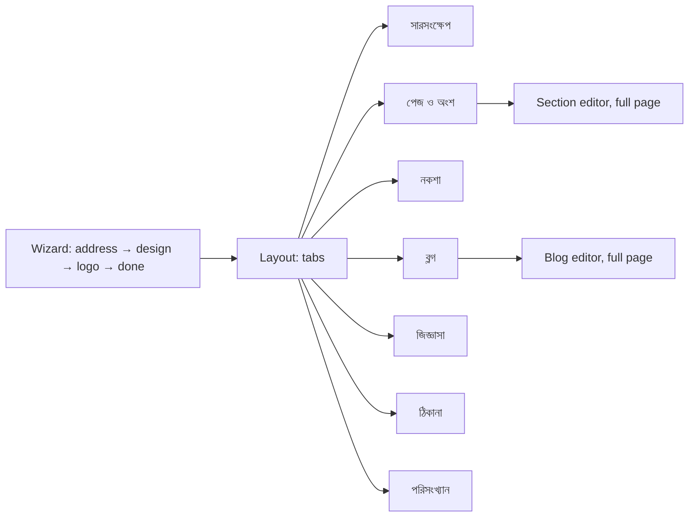

# Epic 40 — admin screen mockups (Administration › ওয়েবসাইট)

Kit-based mockups (`.claude/skills/redesign-page/`), one HTML file per screen, shot at 1440 and 390 px into `shots/<name>-{1440,390}.png`. Built for ticket #3612 (40.0.02); the usability test (#3614) runs on these.

Layout: staff shell, `DetailShell` (breadcrumb প্রশাসন › ওয়েবসাইট › tab, 7-tab strip). Rule used everywhere: the header "প্রকাশ করুন" is the one filled button, and appears only while there are unpublished changes. Tabs with live-saving content (blog, enquiries, address, analytics) put their own action as the filled button instead.

## Screens

Tickets: wizard/overview/pages/design/section editor/blog/enquiries/address/analytics screens belong to #3632–#3636 (40.3.05–40.3.09) and the layout/nav to #3625/#3626 (40.2.04/05); notice, staff, exam changes to #3651/#3652 (40.5.03/04). Exact ticket-per-screen split is the planner's call; this is the proposed mapping.

| Screen | File | Ticket | States drawn |
|---|---|---|---|
| Wizard 1 · ওয়েব ঠিকানা | `wizard-1-address.html` | #3625 (40.2.04) | free-address tick |
| Wizard 2 · নকশা + রং | `wizard-2-theme.html` | #3625 (40.2.04) | Basic preselected |
| Wizard 3 · লোগো 512×512 | `wizard-3-logo.html` | #3626 (40.2.05) | filled slot, skip |
| Wizard done | `wizard-done.html` | #3626 (40.2.05) | success |
| সারসংক্ষেপ, site on | `overview-on.html` | #3632 (40.3.05) | usage bar 100 MB, switch-off ConfirmDialog |
| সারসংক্ষেপ, site off | `overview-off.html` | #3632 (40.3.05) | empty ("চালু করুন") |
| পেজ ও অংশ | `pages.html` | #3633 (40.3.06) | on/off, up/down, pinned rows |
| Announcement bar editor | `announcement-bar.html` | #3633 (40.3.06) | RepeatableRowForm, from/until, marquee/static, speed |
| Section editor (full page) | `section-editor.html` | #3634 (40.3.07) | bn/en, S/M/L/XL, image slot, preview |
| নকশা | `design.html` | #3634 (40.3.07) | themes, colours, font pairs |
| নকশা, preview loading | `design-loading.html` | #3634 (40.3.07) | loading skeleton |
| ব্লগ list | `blog-list.html` | #3635 (40.3.08) | draft/published |
| Blog editor (full page) | `blog-editor.html` | #3635 (40.3.08) | bn/en, cover 1200×630 |
| জিজ্ঞাসা | `enquiries.html` | #3635 (40.3.08) | seen tick, delete ConfirmDialog |
| জিজ্ঞাসা, empty | `enquiries-empty.html` | #3635 (40.3.08) | empty + copy link |
| ঠিকানা | `address.html` | #3636 (40.3.09) | rename note, own address, 2 copy rows pending |
| ঠিকানা, check failed | `address-check-failed.html` | #3636 (40.3.09) | error, missing line named |
| পরিসংখ্যান | `analytics.html` | #3636 (40.3.09) | 30-day card, Umami link |
| পরিসংখ্যান, empty | `analytics-empty.html` | #3636 (40.3.09) | empty before first publish |
| Notice form ticks | `notice-form-tick.html` | #3651 (40.5.03) | two switches (New) |
| Staff › ওয়েবসাইট প্রোফাইল | `staff-website-profile.html` | #3651 (40.5.03) | photo 400×400 |
| Exam publish on website | `exam-publish-website.html` | #3652 (40.5.04) | ConfirmDialog with names switch |

Error state for the enquiries list and a network-failure state for other tabs reuse the kit `ErrorState` unchanged and are not redrawn.

## Decisions (recommended option taken)

| Decision | Options | Chosen |
|---|---|---|
| Where "প্রকাশ করুন" lives | always in header / only with unpublished changes / per tab | only with unpublished changes, keeps one filled button per view |
| 30-day rename note | old address forwards 30 days / address locked 30 days / both | both sentences; **placeholder wording, confirm in #3632** |
| Palette swatches | real hex / kit tokens as stand-ins | kit tokens (no hex rule); real palettes come from theme data |
| Switch hit area | rely on `::after` / draw 44 px explicitly | drawn explicitly so the phone check passes |
| Breadcrumb root | "Administration" / "প্রশাসন" | "প্রশাসন" (the screen is Bangla; English locale shows Administration) |
| Shoot script | `../site/shoot.mjs` (#3611, not merged yet) / kit script | kit `.claude/skills/redesign-page/scripts/shoot.mjs`, same report; swap when #3611 lands |

New, not in the kit: nav item "ওয়েবসাইট", a Switch row, theme/palette/font-pair cards, image slot with crop note, copyable record rows with status, rich-text editor frame.

## Checks

Ran `.claude/skills/redesign-page/scripts/shoot.mjs` on all 22 screens (1440 desktop and 390 mobile). Real output, summarised:

| Check | Result (22 of 22 screens, both widths) |
|---|---|
| Horizontal overflow | 0px |
| Unlabeled button or link | 0 |
| Tap target under 44px (390 only) | 0 |
| Page errors, `<h1>` count | 0 errors, exactly 1 `<h1>` |

Blog editor toolbar (both languages) carries: bold, italic, paragraph, H2, H3, bullet list, numbered list, table, quote, image, link. Each has a Bangla `aria-label`, 44px at 390, and wraps onto a second row on the phone.
