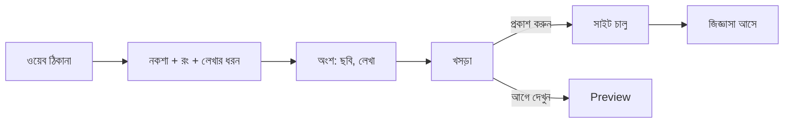

# Epic 40 glossary — school public website

Plain words for every screen, button, message and error of Epic 40 (#820).
Use the **Say** columns in the app. Never use the **Never say** column on a
screen, button, error or alert that office staff or a guardian reads.
Every later Epic 40 screen ticket cites this file in its acceptance.

## Words

| Say (bn) | Say (en) | Never say | Where it shows |
|---|---|---|---|
| ওয়েব ঠিকানা | web address | subdomain | wizard step 1, address tab |
| নিজস্ব ঠিকানা | your own address | custom domain, CNAME, DNS | address tab, guide |
| নকশা | design | theme, template | wizard step 2, design tab |
| রং | colours | palette | design tab |
| লেখার ধরন | text style | typography, font stack | design tab |
| অংশ | section | block, widget | pages tab, section editor |
| খসড়া | draft | unpublished state | pages, blog, header badge |
| প্রকাশ করুন | publish | deploy | header button, wizard done |
| আগে দেখুন | preview | SSR, render | design tab, section editor |
| জিজ্ঞাসা | enquiry | lead, form submission | enquiries tab, nav |
| ঘোষণা বার | announcement bar | marquee, ticker | pages tab editor |
| ছবি | photo | media, asset | every upload slot |
| দেখাও | show on website | is_public | notice form, exam publish |
| হাইলাইট | highlight | featured | notice and blog rows |

## Error rule

An error names what to do next, next to the control that caused it.
Example (address check): "ঠিকানা এখনও মেলেনি। আপনার ঠিকানার সেটিংয়ে নিচের লাইনটি যোগ করুন, তারপর আবার দেখুন।"
Never show a raw DNS or server message.
