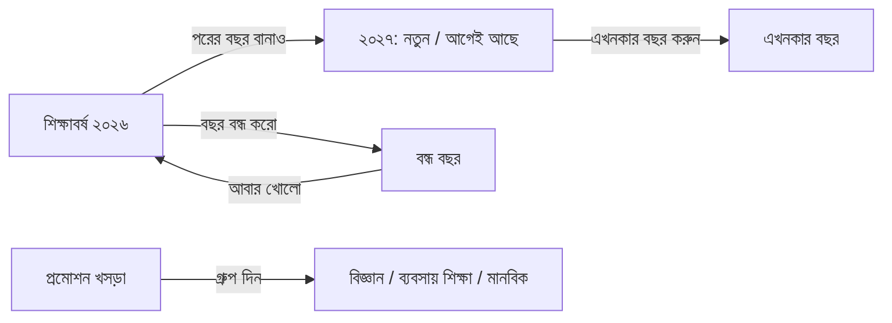

# Epic 69 glossary — year rollover, close year, groups

Plain words for every screen, message and error of Epic 69 (#2202).
Use the **Say** columns in the app. Never use the **Never say** column on a
screen, a button, an error or an alert a teacher reads.

## Words

| Say (bn)                              | Say (en)                      | Replaces (never say)          | Where it shows                                  |
| ------------------------------------- | ----------------------------- | ----------------------------- | ----------------------------------------------- |
| পরের বছর বানাও                         | Create next year              | rollover, clone, copy structure | year list action, wizard title, palette         |
| আগেই আছে                              | already there                 | idempotent, upsert, existing row | wizard step 2 tiles, re-run summary           |
| নতুন                                  | new                           | created row, insert           | wizard step 2 tiles                             |
| বাদ পড়েছে                            | skipped                       | filtered, dropped             | skipped staff note in step 2                    |
| বছর বন্ধ করো                          | Close year                    | lock, freeze, archive         | year detail button, dialog title, palette       |
| আবার খোলো                             | Reopen year                   | unlock, unfreeze              | year detail button, dialog title                |
| বন্ধ                                  | Closed                        | locked, frozen, archived      | status badge, notice bar                        |
| এখনকার বছর                            | Current year                  | active year                   | badge, set-current dialog                       |
| এখনকার বছর করুন                       | Set as current year           | activate, switch year         | year list row, dialog                           |
| বাকি আছে                              | Pending                       | TODO, blocker, missing        | dialog count rows, group column                 |
| গ্রুপ                                  | Group                         | stream, segregation           | groups page, My class card                      |
| গ্রুপ দিন                              | Set group                     | assign stream, bulk update    | groups page button                              |
| সব মিলেছে বাছুন                        | Select all that match         | select all filtered           | groups page                                     |
| শর্ত দিয়ে খুঁজুন                      | Find by condition             | rule filter, query            | groups page filter card                         |
| ফলাফল প্রকাশিত                         | Result published              | committed result              | groups page source line                         |
| রুটিন / ক্যালেন্ডার / নিয়ম / সময়সূচি আনুন | Bring routine / calendar / rules / schedule | clone, copy routine | wizard step 3 buttons                    |

**Never say:** rollover, clone, copy structure, idempotent, upsert, lock,
freeze, archive, stream, segregation, active year, TODO, blocker.
(Component tests added by the screen tickets fail if one shows in rendered text.)

## Words the mockups needed (added beyond the epic list)

| Say (bn)                   | Say (en)                     | Never say          | Where                      |
| -------------------------- | ---------------------------- | ------------------ | -------------------------- |
| বন্ধ হলে যা আর বদলাবে না     | What can no longer change    | frozen modules     | close dialog list          |
| এখন যা বাকি আছে              | What is still pending        | warnings, blockers | close dialog counts        |
| শিক্ষকের দায়িত্ব            | Teacher assignments          | teaching rows      | wizard step 2, set-current |
| তবুও এখনকার বছর করুন         | Set as current anyway        | force, override    | set-current confirm button |

## One-sentence error (D, Rules 23/24)

"এই বছর বন্ধ। বদলাতে শিক্ষাবর্ষ পাতায় গিয়ে আবার খুলুন।"
(en: "This year is closed. Reopen it on Academic years to change this.")
