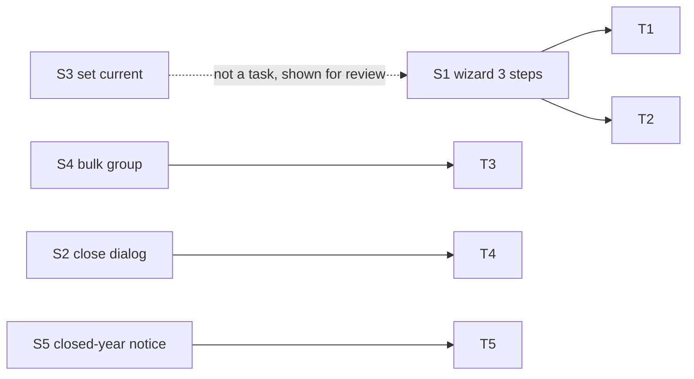
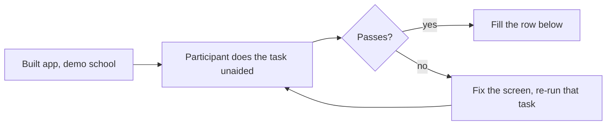

# Epic 69 usability test: year rollover, close, groups (status: NOT RUN YET)

Ticket 69.1.06 (#3513) asks for clickable mockups and a test of tasks T1 to T5
with one clerk, one class teacher and one head teacher. **The mockups are built.
The test needs real school staff and has not been run.** This file is the script
and the place to record results. The ticket's acceptance box "five tasks pass
unaided for all three participants" stays **unticked** until the table below is
filled and every row passes.

## Mockups

Files live in `docs/ux-research/epic-69-mockups/`. Each has a `.html`, a
1440 px and a 390 px PNG. They use the real design tokens and the shared kit
(`FullPageShell`, `Stepper`, `Dialog`, `ConfirmDialog`, `NoticeBar`, `StatusBadge`).
Fake names only.

| Screen    | File                    | What it shows                                                                                     |
| --------- | ----------------------- | ------------------------------------------------------------------------------------------------- |
| S1 step 1 | `s1-step1`              | Name "২০২৭" and dates prefilled (source end + 1 day, + 1 year)                                    |
| S1 step 2 | `s1-step2`              | Tiles "নতুন / আগেই আছে" per block, untick per block, skipped staff note                           |
| S1 step 3 | `s1-step3`              | Done + four copy buttons, each with its own miss line                                             |
| S2        | `s2-close`, `s2-reopen` | Close dialog: what can no longer change + live counts; Reopen dialog                              |
| S3        | `s3-set-current`        | ConfirmDialog with three readiness lines and a warning                                            |
| S4        | `s4-groups`             | Filter (GPA, subject, mark bound), select-all, group select, apply; phone = cards + filter button |
| S5        | `s5-closed-year`        | NoticeBar on the marks grid, disabled Save, one next-step sentence                                |

Shoot report (`shoot.mjs`): no sideways scroll, one `<h1>` each, no unlabeled
buttons, no page errors at 1440 or 390. The only `smallTargets` flagged are the
20 px checkboxes in S1 step 2 and S4; each sits inside a 44 px label/row, so the
whole row is the tap target.

## Tasks (participants' own words)

| #   | Who           | Task                                                                             | Screen                                                                             | Target                        |
| --- | ------------- | -------------------------------------------------------------------------------- | ---------------------------------------------------------------------------------- | ----------------------------- |
| T1  | Clerk         | "Make 2027 like 2026"                                                            | S1                                                                                 | 3 min, unaided                |
| T2  | Clerk         | "Find and raise the 2027 tuition fee"                                            | S1 step 2 tile "ফি-র তালিকা", then the existing fee-structure page (no new screen) | 2 min                         |
| T3  | Class teacher | "Set groups for 60 class-8 students: maths above 60 to Science, rest Humanities" | S4                                                                                 | 5 min, unaided                |
| T4  | Head teacher  | "Close 2026; first say what can no longer change"                                | S2                                                                                 | 3 min + correct verbal answer |
| T5  | Class teacher | "Try to change a 2026 mark; say why it failed"                                   | S5                                                                                 | 1 min                         |

Correct answer for T4: results and marks, admission and promotion, new fee bills,
routine and attendance dated in 2026 stop changing; payment of old dues still works.

## Results (fill in on the day)

| Task | Participant   | Time | Unaided? | Where they hesitated | Change made | Pass? |
| ---- | ------------- | ---- | -------- | -------------------- | ----------- | ----- |
| T1   | clerk         |      |          |                      |             |       |
| T2   | clerk         |      |          |                      |             |       |
| T3   | class teacher |      |          |                      |             |       |
| T4   | head teacher  |      |          |                      |             |       |
| T5   | class teacher |      |          |                      |             |       |

Rules: fix the mockup after any failure and re-run that task on the final
mockups (rebuild with the redesign-page kit, re-shoot, re-upload).

## Uploaded PNGs (never cite scratch paths)

Issue-comment URLs, to be added after upload:

- S1 step 1/2/3, S2 close/reopen, S3, S4, S5: _pending upload to #3513 (needs a
  hosting step that this lane did not perform)._

## Built-screen re-check (#3538, status: PENDING, needs real school staff)

After wave 4 the mockups exist as real screens. Ticket #3538 step 4 asks for T1, T2, T4 and
T5 to be re-run **by the same participants** on the built app. An agent cannot do that, so
**no result is recorded here and none is invented**. This is a human to-do.

What each task should do on the built screens (where the participant should end up, and
what "pass" looks like). The e2e specs `e2e/journeys/year-rollover.spec.ts` and
`e2e/journeys/year-close.spec.ts` prove the same paths work technically. They do not prove a
person finds them.

| Task                                                             | Built screen and expected behaviour                                                                                                                                                                                                                                                          | Result                                         |
| ---------------------------------------------------------------- | -------------------------------------------------------------------------------------------------------------------------------------------------------------------------------------------------------------------------------------------------------------------------------------------- | ---------------------------------------------- |
| T1 Clerk: "Make 2027 like 2026"                                  | Academic years, row action "Create next year" (or Ctrl+K "Create next year"). Name "2027" and dates are prefilled. Next shows one tile per block with "New / Already there / Skipped". "Create year" lands on a Done step. Running it again shows "Already there" counts, not duplicates.    | PENDING, needs real school staff (human to-do) |
| T2 Clerk: "Raise the 2027 tuition fee"                           | Done step link "Next: check fee amounts on Fee structures" opens the new year's Fee Structures tab. The amount is edited on the existing fee-structure page.                                                                                                                                 | PENDING, needs real school staff (human to-do) |
| T4 Head teacher: "Close 2026; say what can no longer change"     | Year page, "Close year". The dialog lists "What will no longer change" with live counts (Exams, Bills, Enrolments) and says payments can still be taken. Close asks for the approval code. The header then shows "Closed on ...". An open promotion draft blocks it and links to Promotions. | PENDING, needs real school staff (human to-do) |
| T5 Class teacher: "Try to change a 2026 mark; say why it failed" | The marks grid of a closed year shows the notice "... is closed. Reopen it on Academic years to change this.", cells are read-only and there is no Submit button. A save that races the close shows the same sentence beside the save state.                                                 | PENDING, needs real school staff (human to-do) |

T3 (bulk groups) is not in the #3538 re-check list. It stays in the table above.

Fill in on the day with the same columns as "Results", then tick #3513's box only if every
row passes.

## Built-screen re-check of T3 (#3540, status: PENDING, needs real school staff)

Wave 5 built the groups page (`/promotions/$runId/groups`, #3539). Ticket #3540 step 2 asks
for T3 to be re-run **with a real class teacher** on the built screen. An agent cannot do that,
so **no result is recorded and none is invented**. This is a human to-do.

| Task                                                         | Built screen and expected behaviour                                                                                                                                                                                                        | Result                                         |
| ------------------------------------------------------------ | ------------------------------------------------------------------------------------------------------------------------------------------------------------------------------------------------------------------------------------------ | ---------------------------------------------- |
| T3 Class teacher: "Give the students with maths 60+ Science" | My class, card "Groups pending: K", "Set groups". Filter: Subject (maths), "Marks at least" 60. "Select all matching", pick the group, "Apply to N". A green notice says how many were set. The run page then shows the group on each row. | PENDING, needs real school staff (human to-do) |

`e2e/journeys/promotion-groups.spec.ts` proves the path works technically. It does not prove a
person finds it. Tick #3540's T3 box only after this row is filled and passes.

## Wave 5 learnings

Format: surprise, cost, fix, rule candidate.

- **The groups route needs a trailing underscore.** `$runId.tsx` has no `<Outlet />`, so a child
  file `$runId.groups.tsx` matched but rendered nothing. Cost: a blank page that type-checked.
  Fix: `$runId_.groups.tsx` (its own chromeless page). Rule candidate: a new sibling under a route
  file without an outlet uses the `name_` form.
- **`GET /promotions/:id/groups` is typed `never` in `ui/src/api/schema.d.ts`.** The generated
  type has no response body, so the hook declares its own `PromotionGroupEntry` shape. Cost: the
  type is not checked against the server. Fix: hand-written type next to the hook. Rule
  candidate: type the response of every new route (`@ApiOkResponse`) so `api:types` carries it.
- **The server rejects `marks_min` without `subject_code`.** Cost: a 400 when a teacher typed
  marks first. Fix: `toGroupFilters` drops `marks_min` until a subject is chosen. Rule candidate:
  filters that depend on another filter are dropped in the client mapper, not shown as errors.
- **The attention item's `actionUrl` points at a page teachers cannot open.**
  `server/src/modules/attention/rules/promotions/promotion-groups-pending.rule.ts:81` sets
  `/promotions/${runId}`, which needs `PROMOTION_MANAGE`. The My class card works around it by
  reading the run id out of that URL. **Follow-up (not fixed here):** point the item at
  `/promotions/${runId}/groups` for teachers.
- **The pending card only appears after the attention sweep.** Nothing can trigger the rule on
  demand (FAST sweep every 5 minutes), so the e2e spec waits 20 s for the card and otherwise opens
  the page by URL, with an annotation. Rule candidate: a rule a journey must reach needs an
  event-driven recheck.
- **A partly failed multi-chunk apply is hard to word.** Apply sends 500 ids per call; if call 2
  fails, call 1 is already saved. Fix: the message says "Some students may already be set, so
  check the list and try again." Rule candidate: say what is already saved, never "nothing
  changed", when a write is chunked.
- **The admin has no section filter on the groups page.** The server has no `section` parameter,
  so an admin sees the whole class. Cost: a large class is hard to do one section at a time.
  Follow-up: add `section_id` to `GET /promotions/:id/groups` and a filter field.
- **A teacher with a homeroom elsewhere gets a 404, not an empty list.** Only a teacher with no
  homeroom gets an empty list (`promotion-groups.service.ts:137` vs `:148`). The page shows its
  load-error state for the 404. Rule candidate: say in the ticket which of the two "empty"
  cases a journey means.
