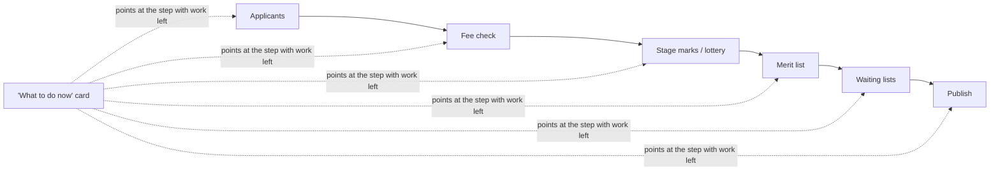

# Epic 71 admission desk: built-screen usability re-check (wave 4 close)

> **This is a simulated heuristic pass, not a human test.** One reviewer walked the built screens
> against the five tasks in the epic (#2204, "Usability test"). No office staff or guardian took part,
> and no task was timed by a person. The real test (#4169: clickable mockups, 2-3 office staff,
> 1-2 guardians) is still open, and so are the files it was meant to leave behind
> (test plan, glossary, mockups; on branch `epic/71/w0-g1-01-ux`). Treat every "pass" below as
> "no obvious blocker found", never as "a person did it in time".

## What was checked, and how

| Source                                                                                                       | Used for                                                            |
| ------------------------------------------------------------------------------------------------------------ | ------------------------------------------------------------------- |
| `AdmissionDesk.tsx`, `next-action.ts` (+ unit test)                                                          | which card shows when, which step opens                             |
| `DeskStepper.tsx`, `StageScoreGrid.tsx`, `ClerkEntryPage.tsx`, `FeeVerifyDialog.tsx`, `PublicationPanel.tsx` | keys, labels, states                                                |
| `e2e/journeys/admission-pipeline.spec.ts`, `e2e/keyboard/admission-desk.spec.ts`                             | the same tasks driven by Playwright in CI (a machine, not a person) |
| Heuristics                                                                                                   | Nielsen 1, 3, 5, 6, 9 and `docs/architecture/15-ux-principles.md`   |

## The five tasks

| #   | Task (epic limit)                                         | Path on the built screens                                                                                                              | Heuristic result                                                                                                                                                                     |
| --- | --------------------------------------------------------- | -------------------------------------------------------------------------------------------------------------------------------------- | ------------------------------------------------------------------------------------------------------------------------------------------------------------------------------------ |
| 1   | Open the class 1 round and show it on the website (5 min) | Rounds list, open the round, step "Admit" (`PublicationPanel`): the website switch and the SMS-cost estimate sit on one panel.         | No blocker. Risk: the step is called "Admit" but also holds publishing, so a first-time user may look for "Website" in the stepper. Confirm with real staff.                         |
| 2   | A guardian walked in: enter the application (2 min)       | `Ctrl+K`, clerk entry full page; boxes come from the round's ticked fields.                                                            | No blocker. Risk: a round that requires a photo needs a file pick, the slowest part; the 2-minute limit depends on that.                                                             |
| 3   | Enter written-test marks and build the merit list (5 min) | "Enter marks" card opens the stage; grid moves down with Enter or Arrow Down, `A` marks absent; cut-off preview, then "Make the list". | No blocker. Keyboard path is real (spec above). Risk: cut-off preview must be read before commit; wording was not tested on a person.                                                |
| 4   | Check a fee screenshot and confirm it (1 min)             | "Check fees" card opens Applicants; the dialog shows the file, amount, method and reference with Confirm and Send back.                | No blocker. One dialog, two buttons, file in the same view. Reason box only matters for send back.                                                                                   |
| 5   | Guardian on a phone: apply and look up the result (4 min) | School-site pages, not the staff app.                                                                                                  | **Not re-checked.** The browser pages need the site container, which the e2e stack does not run. `site-admission.spec.ts` covers only the API. Needs the human test on a real phone. |

## Findings to carry forward

1. The glossary, mockups and test plan from #4169 live on branch `epic/71/w0-g1-01-ux` (unmerged, human test pending). Word choices were not checked against the glossary.
2. Task 5 has no browser coverage anywhere. The phone sweep in this ticket covers the staff screens only.
3. Phone width: the stepper turns into a `Select` below `sm`. The `Select` trigger is `min-h-11` (44 px), as the target-size sweep needs.
4. The wizard-made round has no total marks (cut-off hidden, desk card never completes): https://github.com/tareq89/biddaloy/issues/4315.
5. Nothing here replaces timing a person. Do #4169 before treating the desk as usable.
