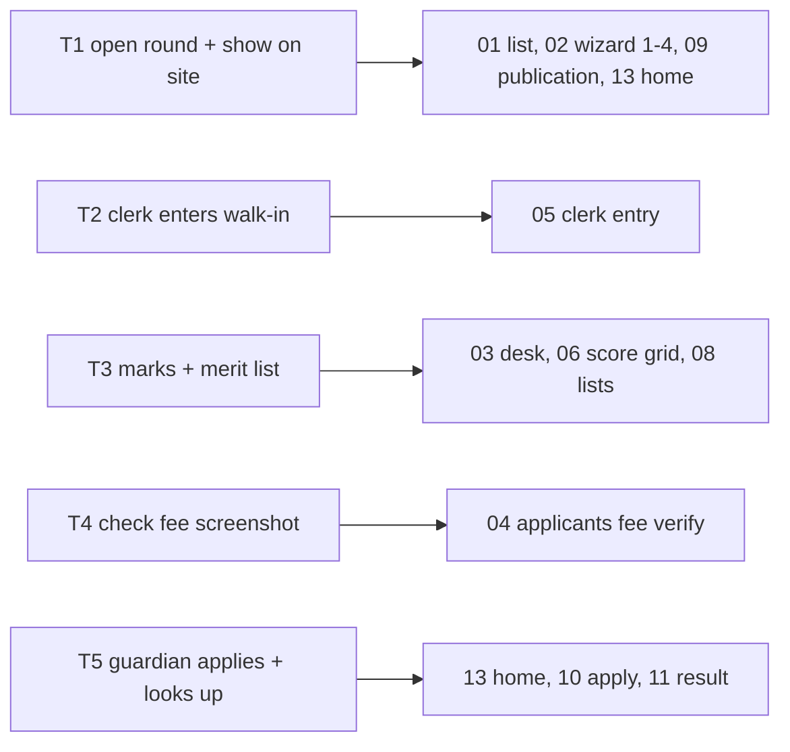

# Epic 71 usability test plan: admission pipeline

Ticket #4169 (Epic #2204). Status: **mockups built, test NOT RUN**.
Run it with 2-3 office staff and 1-2 guardians. Fill
[`epic-71-admission-findings.md`](epic-71-admission-findings.md). Words to use on screen:
[`epic-71-admission-glossary.md`](epic-71-admission-glossary.md).

## The five tasks

| # | Who | Say this (never name a button) | Limit | Start page |
|---|---|---|---|---|
| T1 | office staff | "Open the class 1 admission round and make it show on the school website." | 5 min | `01-rounds-list.html` |
| T2 | office staff | "A parent walked in with a form. Enter the application." | 2 min | `03-desk-written.html` |
| T3 | office staff | "The written test is done. Enter the marks and make the merit list." | 5 min | `03-desk-written.html` |
| T4 | office staff | "This parent paid by bKash. Check the screenshot and confirm the fee." | 1 min | `04-applicants.html` |
| T5 | guardian, on a phone (390 px) | "Apply for your child. Later, find out the result." | 4 min | `13-site-home.html` |

Pass = done **unaided** and inside the limit. Any hint from you = fail for that
person and task. Staff do T1-T4 (T5 optional); guardians do T5 only.

## How to run (15 min per person)

1. Open the first page in a browser. Staff: 1440 px window. Guardian: a real phone, or a 390 px window.
2. Read the task sentence once. Start a timer. Say nothing else.
3. Note every pause over 3 seconds and every wrong click. Write what the person said out loud.
4. Stop at done, at the limit, or when they give up.
5. Ask: "Which word confused you?" Write the answer.

All pages link to each other; click through the real flow. Not clickable on
purpose: Save and Submit buttons only link to the next screen.

## Screens (22 pages, each at 1440 and 390 px)

| File | Screen |
|---|---|
| `01-rounds-list` | rounds list |
| `02-wizard-1..4` | create-round wizard (4 steps) |
| `03-desk-written`, `03b-viva`, `03c-apply-only`, `03d-lottery`, `03e-fcfs`, `03f-gpa` | Admission desk, one per template |
| `04-applicants` | applicants and fee verify |
| `05-clerk-entry` | clerk entry |
| `06-score-grid` | score grid (phone shows "use a computer") |
| `07-lottery` | lottery |
| `08-lists`, `08b-call-list` | merit and waiting lists, call list |
| `09-publication` | results and publication settings |
| `10-site-admission`, `11-site-result`, `12-site-lists`, `13-site-home` | school site: apply, result lookup, lists, home flag + three widgets |

Files live in `epic-71-mockups/` as `NAME.html`, `NAME-1440.png`, `NAME-390.png`.

## Known limits of the mockups

- The left menu is the kit's sample menu; the real change adds Admissions under People (epic UX requirements).
- Public site pages use the kit's guest styling, not a school theme.
- Rewrite the mockup after each failure, then rerun only the failed task.
