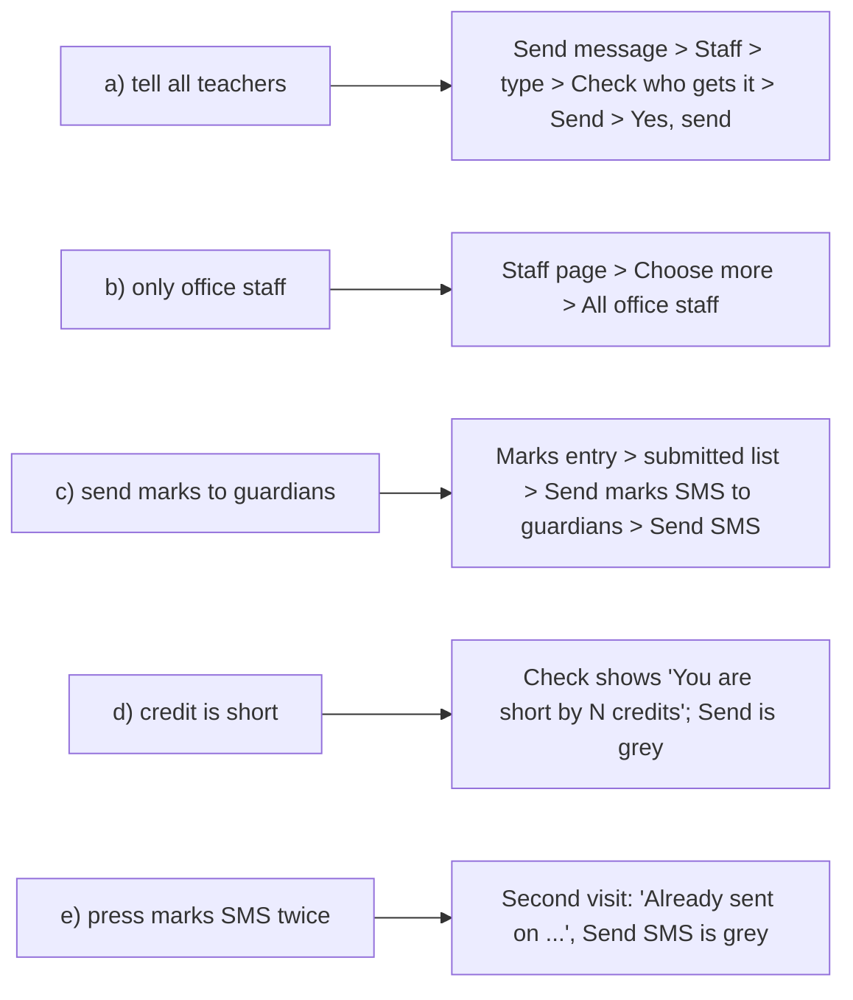

# Epic 80 usability test: staff messages and marks SMS (status: NOT RUN YET)

Ticket 80.4.99 (#4349) asks for the five tasks of the epic ("Usability test" in #2827) to be run once more
on the built screens. **The test needs 2 or 3 real school staff (an office assistant, a teacher, an
admin). It has not been run.** The "tasks passed unaided" box stays **unticked** until the Results
table below is filled in and every row passes.

What was checked without people (a developer reading the built screens, not a usability result):

## Tasks and the path the screens give

| Task, in their words                                 | Target     | Path in the built screens                                                                                                    | Unaided steps (from code)           |
| ---------------------------------------------------- | ---------- | ---------------------------------------------------------------------------------------------------------------------------- | ----------------------------------- |
| a) "Tell all teachers school is closed tomorrow"     | under 90 s | Communications > Send message > Staff. **All teachers** already ticked. Type, **Check who gets it**, **Send**, **Yes, send** | 5 (tab, type, check, send, confirm) |
| b) "Message only the office staff"                   | under 90 s | Same page. Untick **All teachers**, **Choose more**, tick **All office staff**, check, send                                  | 7                                   |
| c) "Send the class-test maths marks to guardians"    | under 90 s | Marks entry > the submitted list > **Send marks SMS to guardians** > **Send SMS**                                            | 3 after opening the list            |
| d) "Say what to do when credit is short"             | answer     | The check shows **You are short by N credits** and **Add credit, or send to fewer people.**; **Send** is grey                | reading only                        |
| e) "Press the marks SMS twice and say what happened" | answer     | The second visit says **Already sent on ...** and **Everyone has already got this.**; **Send SMS** is grey                   | reading only                        |

The glossary "never say" words (recipient, audience, payload, segment, ledger, batch) do not appear in the
English or Bangla catalogs for these screens (`staffMessage.*`, `marksSms.*`); unit tests on both screens
check this.

## Results (fill in after the real sessions)

| Task | Participant | Role | Time | Unaided? | Where they stopped or guessed | Fix filed |
| ---- | ----------- | ---- | ---- | -------- | ----------------------------- | --------- |
| a    |             |      |      |          |                               |           |
| b    |             |      |      |          |                               |           |
| c    |             |      |      |          |                               |           |
| d    |             |      |      |          |                               |           |
| e    |             |      |      |          |                               |           |
