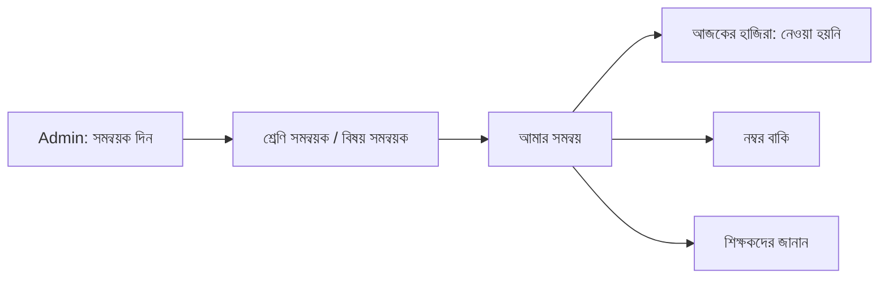

# Epic 83 glossary — coordinators

Plain words for every screen, message and error of Epic 83 (#2830).
Use the **Say** columns in the app. Never use the **Never say** column on a
screen, in a button, in an error or in an alert a teacher reads.

## Words

| Say (bn)        | Say (en)            | Replaces (never say)          | Where it shows                                   |
| --------------- | ------------------- | ----------------------------- | ------------------------------------------------ |
| সমন্বয়ক        | Coordinator         | assignment, assignment row    | Teaching assignments tab, staff and class detail |
| শ্রেণি সমন্বয়ক | Class coordinator   | class-level row, subject NULL | kind badge, assign dialog, guide                 |
| বিষয় সমন্বয়ক  | Subject coordinator | subject-level row             | kind badge, assign dialog, guide                 |
| আমার সমন্বয়    | My coordination     | scope, slice, oversight       | nav item, page title, palette                    |
| আজকের হাজিরা    | Today's attendance  | check-list                    | card block                                       |
| নেওয়া হয়নি    | Not taken           | missing session               | section row badge                                |
| নম্বর বাকি      | Marks pending       | overdue grid, outstanding     | card block                                       |
| শিক্ষকদের জানান | Notify teachers     | manual alert, audience        | page button, dialog title, palette               |
| সমন্বয়ক দিন    | Assign coordinator  | grant, create row             | tab button, dialog title, palette                |
| সমন্বয়ক সরান   | Remove coordinator  | delete row, revoke            | row action, confirm dialog                       |

**Never say:** scope, slice, grant, recipient, assignment row, audience, widen.
Two component tests (`teaching-assignments.test.tsx`, `my-coordination/index.test.tsx`)
fail if one of these words shows in the rendered text.

**Kept as it is (D17):** the EXECUTIVE role stays "Academic coordinator"
(একাডেমিক কো-অর্ডিনেটর). The new words are always "Class coordinator" or
"Subject coordinator", never a bare "Coordinator" next to a role name.
