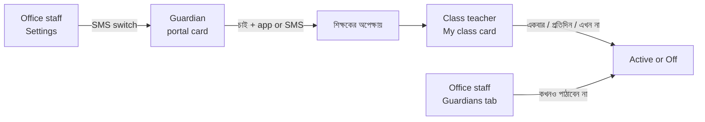

# Epic 84 usability test — arrival notices

Ticket #3150 (84.0.1) of Epic #2835. Decisions: D2, D5, D9, D10, D17, D34, D35.
Words come from [`epic-84-glossary.md`](epic-84-glossary.md).

**Status: mockups built and checked. The human test run has NOT happened yet.**
The results table below is blank on purpose.

## What is being tested

Four screens, built from the app's real tokens (`redesign-page` kit). Each
file is in [`epic-84-mockups/`](epic-84-mockups/): `.html` source, `-1440.png`
desktop, `-390.png` phone.

| Screen                                                                                | Task | Mockup              | Ticket that builds it |
| ------------------------------------------------------------------------------------- | ---- | ------------------- | --------------------- |
| Portal › Attendance › "আগমন বার্তা" card, one row per child                           | T1   | `portal-card`       | 84.4.1                |
| My class › section card (requests, active list, count badge) + "নিজে যোগ করুন" dialog | T2   | `my-class-card`     | 84.3.2                |
| Student › Guardians tab, per-guardian switch + admin menu                             | T3   | `guardians-tab`     | 84.3.3                |
| Settings › Attendance policy & times, two new switches                                | T4   | `settings-switches` | 84.3.5                |

Known limit of the mockups: they are static pictures (open dialog and menu are
drawn on the page), so "clickable" means the tester points and says what they
would press. The facilitator then shows the next picture.

## Participants

| #   | Who                           | Must be true                  | Tasks  | Name / date |
| --- | ----------------------------- | ----------------------------- | ------ | ----------- |
| P1  | Guardian, **with** the app    | has a child in school         | T1     | _blank_     |
| P2  | Guardian, **without** the app | never installed it            | T1     | _blank_     |
| P3  | Class teacher                 | is class teacher of a section | T2     | _blank_     |
| P4  | Office staff                  | works in the school office    | T3, T4 | _blank_     |

Use first names only in this file. No phone numbers, no photos, no real child
names (the repo is public).

## Tasks and targets

Target for every task: done **unaided** (no hint from the facilitator) in
**under 2 minutes**. Mockups stay fixed until all four pass.

| Task | Say this (bn, as read to the tester)                                                                               | Success =                                                                                                                     | Screen        |
| ---- | ------------------------------------------------------------------------------------------------------------------ | ----------------------------------------------------------------------------------------------------------------------------- | ------------- |
| T1   | "নুসরাত স্কুলে পৌঁছালে SMS-এ জানতে চান।"                                                                           | Switch on for Nusrat **and** "SMS-এ" chosen. Notices the "app only" sentence on the other child and does not try to fight it. | portal        |
| T2   | "রহিমা অনুরোধ করেছেন, শুধু পরের বার পৌঁছানোর খবরটা চান।" (the request in the list; "only the next arrival" = once) | Presses **একবার** on that request.                                                                                            | my class      |
| T3   | "এই অভিভাবককে কখনও পাঠাবেন না।"                                                                                    | Opens the ⋯ menu on the right row, picks **কখনও পাঠাবেন না**.                                                                 | guardians tab |
| T4   | "স্কুলের জন্য SMS-এ আগমন বার্তা চালু করুন।"                                                                        | Turns on the **আগমন বার্তা SMS-এ** switch and presses save.                                                                   | settings      |

## Test script (about 10 minutes per person)

1. Welcome. Say: "We test the screen, not you. Nothing you do is wrong."
2. Ask for permission to note timings. Start no recording.
3. Show the **before** page in one sentence ("this is the school app, page X").
4. Read the task (table above). Say nothing else. Start the timer when you stop talking.
5. Ask them to think aloud. Do not hint. If silent for 20 seconds, ask only "What are you looking for?".
6. Stop the timer when they say "done" or point at the right control. Also stop at 2:00 and mark **fail**.
7. Ask: "In your own words, what does the button/switch do?" and "What will happen next?" (checks they read the words right).
8. Record time, unaided yes/no, hesitation point, words they used for the thing.
9. Thank them. Next task.

Fix rule: if anyone hesitates more than 10 seconds at one control, or says a
word that is not in the glossary for something on screen, count it as a
finding even if they passed.

## Results (fill in on the human run)

| Task | Person | Time (m:ss) | Unaided? (y/n) | Where they hesitated | Words they used | Pass (<2:00 and unaided) |
| ---- | ------ | ----------- | -------------- | -------------------- | --------------- | ------------------------ |
| T1   | P1     |             |                |                      |                 |                          |
| T1   | P2     |             |                |                      |                 |                          |
| T2   | P3     |             |                |                      |                 |                          |
| T3   | P4     |             |                |                      |                 |                          |
| T4   | P4     |             |                |                      |                 |                          |

## Changes made after testing

| Round | Screen | What was unclear | Change | Re-test result |
| ----- | ------ | ---------------- | ------ | -------------- |
|       |        |                  |        |                |

Repeat rounds until every row above is a pass.

## Design notes from building the mockups

- One column on phone, three full-width buttons per request, every control 44 px.
- The switch is the real `Switch`; its tap target is 44 px (the screenshot tool measures only the 24 px track).
- No filled primary button on the My class card: the teacher's three choices are equal, so none is pushed.
- Every error sentence sits directly under the control it explains.
- Open questions for the human run: does "একবার" read as "next message only" without help? Does "হয়ে গেছে" read as finished, not failed?
