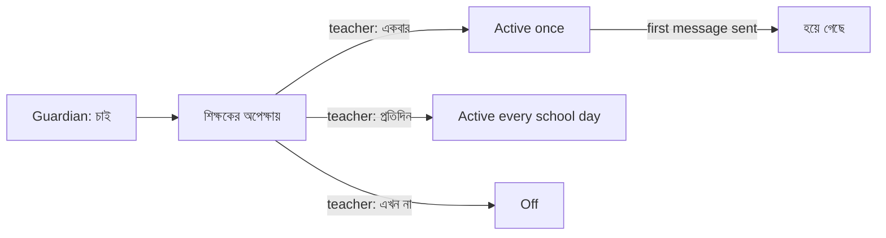

# Epic 84 glossary — arrival notices

Plain words for every screen, message and error of Epic 84 (#2835).
Use the **Say** column in the app. Never use the **Never say** column on a
screen, in a button, in an error or in a message a guardian reads.

## Words

| Say (bn)               | Say (en)            | Replaces (never say)       | Where it shows                                      |
| ---------------------- | ------------------- | -------------------------- | --------------------------------------------------- |
| আগমন বার্তা            | Arrival notice      | subscription, notification | card titles, settings switch, tab heading           |
| চাই                    | Want it             | subscribe, enable          | guardian switch (on)                                |
| চাই না                 | Stop                | unsubscribe, disable       | guardian switch (off), teacher's "stop" button      |
| একবার                  | Once                | one-shot, ONCE             | teacher button, radio                               |
| প্রতিদিন               | Every school day    | recurring, RECURRING       | teacher button, radio                               |
| এখন না                 | Not now             | decline, reject            | teacher button                                      |
| শিক্ষকের অপেক্ষায়     | Waiting for teacher | REQUESTED, pending         | status badge                                        |
| হয়ে গেছে              | Done                | consumed, expired          | status badge after a "Once" message was sent        |
| অ্যাডমিন ঠিক করেছেন    | Set by school       | lock, locked, override     | line under a guardian whose choice the school fixed |
| অ্যাপে                 | In the app          | push, notification         | where the message goes                              |
| SMS-এ                  | By SMS              | channel, medium            | where the message goes                              |
| কীভাবে জানবেন          | How to tell you     | channel, mode              | label above the app / SMS choice                    |
| নিজে যোগ করুন          | Add yourself        | create subscription        | teacher button + dialog title                       |
| অভিভাবক নিজে ঠিক করবেন | Guardian decides    | lock NONE                  | admin menu item                                     |
| সবসময় পাঠান           | Always send         | lock ALWAYS                | admin menu item                                     |
| কখনও পাঠাবেন না        | Never send          | lock NEVER                 | admin menu item                                     |

### One term per audience (Bangla)

| Audience                                   | bn term      | Why                                                                                             |
| ------------------------------------------ | ------------ | ----------------------------------------------------------------------------------------------- |
| Staff (teacher, admin, settings, palette)  | আগমন বার্তা  | Matches "বার্তা" (message) already used across staff screens.                                   |
| Guardians (portal card, portal guide page) | পৌঁছানোর খবর | Plainer words for a reader who is not in the office. Reads as "news that my child has reached". |

Each term is used only for its own audience. Guide pages that name the portal card
for staff (settings) quote the guardian's label in bold, as the guardian sees it.
**Open:** a native Bangla reader has not checked these two terms yet.

Also never say: **sync, device** (say "গেট ১" or the gate name), **mode**,
**channel**, **push**, **lock**, **subscription**.

## Error and help sentences (always beside the control)

| Where                                               | bn                                                    | en                                                       |
| --------------------------------------------------- | ----------------------------------------------------- | -------------------------------------------------------- |
| Guardian switch is fixed by the school              | অ্যাডমিন ঠিক করেছেন।                                  | Set by the school.                                       |
| Guardian chose the app but has no app on this phone | এই ফোনে অ্যাপ নেই। অ্যাপ চালু করুন বা SMS-এ বেছে নিন। | No app on this phone yet. Install the app or choose SMS. |
| School has SMS off                                  | আপনার স্কুল শুধু অ্যাপে পাঠায়।                       | Your school sends this by app only.                      |
| Teacher says "not now"                              | শিক্ষক এখন চালু করেননি। চাইলে আবার জানান।             | Your teacher has not turned this on. You can ask again.  |
| Settings: SMS switch is off                         | এখন বন্ধ: অভিভাবকেরা শুধু অ্যাপে বেছে নিতে পারবেন।    | Off: guardians can only choose the app.                  |
| Teacher list is empty                               | কোনো অভিভাবক এখনও আগমন বার্তা চাননি।                  | No guardian has asked for arrival notices yet.           |

## Example messages (≤ 2 SMS segments)

| Source                        | Message                                       |
| ----------------------------- | --------------------------------------------- |
| Fingerprint / RFID punch      | নুসরাত আজ সকাল ৮:১২-এ স্কুলে পৌঁছেছে — গেট ১। |
| Teacher finishes the register | নুসরাত আজ সকাল ৯:৩০-এ উপস্থিত — করিম স্যার।   |
