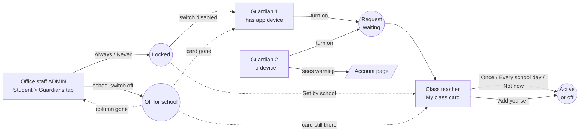

# Epic 84 arrival notices: self-run task walkthrough

Issue: #3150. Code under test: `origin/followup/84/d-client` at `7714da214`
(lane D client UI). This report and its screenshots apply only to that revision, not to the
head of the PR that carries this file; re-run before relying on them for later changes. Dev build (Vite dev server + Nest dev server), fresh test DB, Bangla locale,
Chromium via Playwright, at 390 x 844 and 1280 x 800.

## What this is NOT

- **Not a usability test.** There were no real guardians, class teachers or office staff.
- It was run by Claude, scripted in Playwright, acting as 4 personas. Findings are
  task-completion plus friction observations, not user-research evidence.
- **Times are script speed** (milliseconds between actions). They say nothing about how long a
  person would take, so no "under 2 minutes" claim is made. Step counts are the number of
  deliberate clicks or typed inputs a person would need, counted from the script.
- It does **not** satisfy the #3150 acceptance lines ("passed unaided by every participant",
  "mockups attached"). The issue stays open for real participants.
- The guardian "push device" was **simulated**: for Guardian 1 the browser's
  `GET /me/push/subscriptions` was stubbed to return one device. No real push registration.
- Not covered: Bangla copy quality as a native reader, screen readers, slow networks, SMS
  enabled (the school SMS switch was off for the whole run), the "Not now" hint a guardian sees
  after a teacher declines, and the Settings page where the school switch lives.
- Names in the screenshots are test data (`Rahim 1275`, `Guardian A 1275`).

## The flows walked

## Premise corrections (the tasks as briefed vs. what is built)

| Brief said                                   | What the app does                                                                                                                                                               |
| -------------------------------------------- | ------------------------------------------------------------------------------------------------------------------------------------------------------------------------------- |
| Guardian picks Once vs Every day             | **Guardian cannot.** Guardian only turns it on and picks the channel (App / SMS). The teacher picks Once or Every school day. The guardian sees the result as a badge.          |
| Teacher asks a guardian (request flow)       | **No such control.** The request goes the other way: guardian asks, teacher answers. The nearest thing is "Add yourself" (teacher turns it on for a guardian, no request step). |
| Office staff "staff list, filter by student" | There is no arrival list. Path is Students list, search the child, open, Guardians tab (4 steps).                                                                               |
| "School-off message"                         | No message appears when the school switch is off (details under Admin). The `disabled` sentences exist only as error text after a failed save.                                  |

## Guardian (2 personas: A with app device, B without)

Screenshots: `epic-84-self-walkthrough/{390,1280}-guardian-*.png`

| Task                               | Done                          | Steps                              | Friction                                                                                                                                                                                          | Fix suggestion                                                                              |
| ---------------------------------- | ----------------------------- | ---------------------------------- | ------------------------------------------------------------------------------------------------------------------------------------------------------------------------------------------------- | ------------------------------------------------------------------------------------------- |
| G1: find the control               | Yes (both widths)             | 2 (Attendance in nav, find switch) | Lives only on Portal > Attendance (`/portal/attendance`), under the child's name. I did not capture a usable portal-home view, so whether home points to it is **not checked**.                   | Check home for a pointer; add a link from the home card.                                    |
| G1: turn on                        | Yes                           | 1                                  | Result is a "Waiting for teacher" badge. Guardian never learns Once vs Every day until the teacher answers. No app-device warning shown (correct, device present).                                | Add a line such as "Your teacher chooses how often."                                        |
| G1: pick channel                   | Yes                           | 1                                  | Only "In the app" and "By SMS". SMS is greyed (school off) with "Your school sends this in the app only". Clear.                                                                                  | None.                                                                                       |
| G1: turn off                       | Yes                           | 1                                  | Instant, no confirmation. OK for a reversible switch.                                                                                                                                             | None.                                                                                       |
| G1: see admin lock                 | Yes (after admin ran NEVER)   | 0                                  | Switch disabled, off, hint "The admin fixed this. It cannot be changed here."                                                                                                                     | None.                                                                                       |
| G2: turn on, see no-device warning | Yes                           | 1                                  | Warning appears. **Advice contradicts the screen**: it says "Choose SMS or install the app" while the SMS option directly above is disabled and the line above it says the school sends app only. | Hide "choose SMS" when SMS is not allowed.                                                  |
| G2: follow the warning link        | Yes (loads `/portal/account`) | 1                                  | At 0.9 s the account page showed the top (Profile), not the push-devices section. Anchor `#push-devices` may not have scrolled yet. **Unconfirmed**, re-check on a real device.                   | Verify the scroll-to; show the section first.                                               |
| Both: school switch off            | Card disappears silently      | 0                                  | No explanation. The guardian just stops seeing the card.                                                                                                                                          | Show a one-line "Arrival notices are not on at this school" or accept silence deliberately. |

Link target box at 390: 108 x 15 px. Under 24 px tall, small for a touch target
(`link box {"width":108,"height":15}`).

## Class teacher

Screenshots: `epic-84-self-walkthrough/{390,1280}-teacher-*.png`

| Task                                                | Done                                       | Steps                                             | Friction                                                                                                                                                                                                                                 | Fix suggestion                                                   |
| --------------------------------------------------- | ------------------------------------------ | ------------------------------------------------- | ---------------------------------------------------------------------------------------------------------------------------------------------------------------------------------------------------------------------------------------- | ---------------------------------------------------------------- |
| Find My class arrival card                          | Yes                                        | 2 (My class, open the section)                    | Card title "Arrival notices" sits 2nd on the page; a "2 waiting" badge shows. On mobile the page opens with the card high up. Good.                                                                                                      | None.                                                            |
| Answer requests (Once / Every school day / Not now) | Yes                                        | 2                                                 | Three equal-width buttons per row. "Every school day" is the filled button on both rows, so the default looks pre-chosen. Labels are short, clear.                                                                                       | Make the three buttons equal weight, or say why one is primary.  |
| Add yourself for guardian C                         | Yes                                        | 6 (open, student, guardian, once/every day, save) | Dialog title "Add yourself" is vague: it adds a guardian, not the teacher.                                                                                                                                                               | Rename to "Turn on for a guardian".                              |
| See who is on / off / locked                        | **Partly**                                 | 0                                                 | Active list shows guardian, channel, Once / Every day badge, and "Set by school" for **Always** locks. A guardian under **Never** is **invisible** (row is off with no history, so it is hidden). Declined ("Not now") rows also vanish. | List locked-off guardians too, with "Set by school: off".        |
| Ask a guardian                                      | **Not possible**                           | n/a                                               | Only buttons in the card: Once, Every school day, Not now (while waiting) and Add yourself.                                                                                                                                              | If teachers need to nudge a guardian, that is a missing feature. |
| School switch off                                   | Card still shown with all rows and buttons | 0                                                 | Inconsistent with the portal and Student tab, which hide it. A save would presumably fail with the `disabled` sentence (not exercised).                                                                                                  | Hide or show a "Notices are off at school" banner.               |

### The earlier flag: "Every day" clipped in the Add yourself dialog at 390 px

**Verdict: the text is not clipped; the card's bottom edge is overlapped by the sticky footer.**

Measured with `getBoundingClientRect`, not by eye:

| Measure                        | 390 x 844                                             | 1280 x 800                                        |
| ------------------------------ | ----------------------------------------------------- | ------------------------------------------------- |
| Dialog box (l, t, r, b)        | 16, 122, 374, 723                                     | 360, 163, 920, 637                                |
| "Every day" text box           | x 78, y 526, w 160, h 22 (inside dialog and viewport) | x 422, y 504, w 160, h 22                         |
| Every-day radio card (t, b)    | 513, 578                                              | 491, 556                                          |
| Dialog scroll vs client height | 599 / 599 (no scroll)                                 | 472 / 472                                         |
| Ancestors clipping the card    | none (only the dialog, `overflow:auto`)               | none                                              |
| Sticky footer container top    | about 574                                             | not measured (card bottom 556, dialog bottom 637) |
| Overlap of footer onto card    | **about 4 px** (574 to 578)                           | not measured                                      |

At 390 the element under a point 4 px above the card's bottom edge is the footer wrapper
(`div.sticky.bottom-0.-mx-5.-mb-5.flex.shrink-0.flex-col`), not the label. So the card's
bottom border and rounded corners are covered. The title and caption are fully visible
(`390-teacher-add-dialog-filled.png`). It looks cut off because the border is missing.
Not measured: phone heights shorter than 844 (the dialog should then scroll internally).

## Office staff (ADMIN)

Screenshots: `epic-84-self-walkthrough/{390,1280}-admin-*.png`

| Task                            | Done           | Steps                                           | Friction                                                                                                                                                                                                                                    | Fix suggestion                                                                         |
| ------------------------------- | -------------- | ----------------------------------------------- | ------------------------------------------------------------------------------------------------------------------------------------------------------------------------------------------------------------------------------------------- | -------------------------------------------------------------------------------------- |
| Find the guardian arrival state | Yes            | 4 (Students, search child, open, Guardians tab) | No cross-student arrival list. The "Arrival notice" column is the 6th column; on 390 it is inside a stacked card and needs scrolling.                                                                                                       | Add an arrival filter or a list under Attendance if staff need to audit many students. |
| Lock Always (guardian C)        | Yes            | 2 (row menu, Always)                            | The one menu mixes teacher-style choices (Once, Every day, Stop) with locks (Always, Never, "Let the teacher decide") with only a separator. A first-time user may not see the difference.                                                  | Group with headings: "Set now" vs "Lock".                                              |
| Lock Never (guardian A)         | Yes            | 2                                               | Works. Menu items Once / Every day / Stop turn grey after locking.                                                                                                                                                                          | None.                                                                                  |
| See "Set by / Locked by" lines  | Yes            | 0                                               | Present, with names and dates. But the same fact shows **four times** per row: badge "Set by admin: never", note "An admin fixed this…", "Set by <teacher> on <date>", "Locked by <admin> on <date>". At 390 the cell is 5 to 8 lines tall. | Keep the badge and one "Locked by" line.                                               |
| School switch off               | **No message** | 1                                               | The Arrival column header disappears; nothing says why. Per the code comment, only a lock-holder can even learn the switch is off.                                                                                                          | Show "Arrival notices are turned off at this school" where the column was.             |

Menu screenshot `1280-admin-lock-menu.png` was captured mid-fade, so it looks washed out.

## Top findings

| #   | Severity | Finding                                                                                                                                                                                                                                                                  | Where (file, guess)                                                                                                          |
| --- | -------- | ------------------------------------------------------------------------------------------------------------------------------------------------------------------------------------------------------------------------------------------------------------------------ | ---------------------------------------------------------------------------------------------------------------------------- |
| 1   | Medium   | Never-locked and declined guardians are invisible in My class; teacher cannot "see off / locked" for them.                                                                                                                                                               | `client-admin/src/routes/_staff/my-class/-cards.tsx`, `on` filter (about line 524)                                           |
| 2   | Medium   | School switch off is handled three ways: portal hides, Student tab hides, My class still works. No "off" message anywhere outside error paths.                                                                                                                           | `portal/-arrival-notice-card.tsx` (returns null), `students/-detail/guardians-tab.tsx` (`arrivalOff`), `my-class/-cards.tsx` |
| 3   | Medium   | No-device warning tells the guardian to "choose SMS" when the SMS option is disabled and the line above says app only.                                                                                                                                                   | `portal.json` `arrivalNotice.noPush`; `-arrival-notice-card.tsx` (about line 118)                                            |
| 4   | Low      | Add-yourself dialog at 390: sticky footer overlaps the "Every day" card's bottom edge by about 4 px (text not clipped).                                                                                                                                                  | `-arrival-add-dialog.tsx` / the `DialogContent` sticky footer in `@biddaloy/ui`                                              |
| 5   | Low      | Student tab shows the lock fact four times, tall on phones.                                                                                                                                                                                                              | `students/-detail/-arrival-notice-cell.tsx` (badge, `lockedNote`, `setBy`, `lockedBy`)                                       |
| 6   | Low      | Guardian cannot see or choose Once vs Every day; the brief assumed they could. Product intent, but the wording "I want it" does not set that expectation.                                                                                                                | `portal.json` `arrivalNotice.explanation`                                                                                    |
| 7   | Low      | Warning link target is 15 px tall; `#push-devices` scroll unconfirmed.                                                                                                                                                                                                   | `-arrival-notice-card.tsx`                                                                                                   |
| 8   | Info     | First dry run with a 24-character child name appeared to push the switch past the right edge of the portal card at 390. Not retained and not reproduced with realistic names (switch right edge 333 px vs card edge 374 px). Worth one re-check with a long Bangla name. | `-arrival-notice-card.tsx` header row                                                                                        |

No bug was fixed; no app code was changed.

## Task completion summary (scripted runs, 390 and 1280 gave the same outcomes)

| Persona                 | Tasks completed | Not possible or partial                                             |
| ----------------------- | --------------- | ------------------------------------------------------------------- |
| Guardian with device    | 5 of 5          | Home discoverability unchecked                                      |
| Guardian without device | 4 of 4          | Advice contradiction; anchor scroll unconfirmed                     |
| Class teacher           | 3 of 6          | See locked-off guardians (partial), ask a guardian (does not exist), school switch off (card still shown) |
| Office staff            | 4 of 5          | School-off message (does not exist)                                 |

## Reproduce

The run harness was a throwaway Playwright spec that was not committed, so these numbers and
screenshots cannot be regenerated from this repository. The steps below are the full recipe to
rebuild it.
Setup per run: fresh class section, 2 children, 3 guardians (2 with portal accounts via batch
invite and first sign-in OTP), 1 class teacher, admin session; seed has arrival notices on and
SMS off. Run through `yarn test-env run -- ...` against the dev servers.
