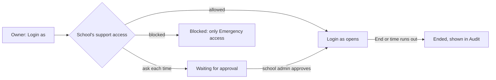

# Tenant control glossary: Login as, School 360, support access

Plain words for every screen, message and error of Epic 99 (#3726), decision D14.
Use the **Say** column on screen. Never use the **Never say** words on a screen, button, error or message.

## Words

| Say (en)                 | Say (bn, to confirm with a native reader) | Never say                    | Where it shows                                |
| ------------------------ | ----------------------------------------- | ---------------------------- | --------------------------------------------- |
| Login as                 | হিসেবে ঢুকুন                              | impersonate, act as          | Schools row button, 360 button, dialog title  |
| End                      | শেষ করুন                                  | end session, revoke, log out | support banner, live strip, school admin list |
| Emergency access         | জরুরি প্রবেশ                              | break-glass                  | dialog link for a blocked school              |
| Biddaloy support access  | বিডডালয় সহায়তা প্রবেশ                   | consent, permission          | Settings tab and card title                   |
| Allowed                  | অনুমতি আছে                                | consent given, opt-in        | support access setting                        |
| Ask each time            | প্রতিবার জিজ্ঞাসা করুন                    | consent per session          | support access setting                        |
| Blocked                  | বন্ধ                                      | opt-out, denied              | support access setting                        |
| Reason                   | কারণ                                      | justification, ticket        | dialog field, request, audit list             |
| No login account         | লগইন অ্যাকাউন্ট নেই                       | no user, inactive            | greyed person in the dialog                   |
| Waiting for approval     | অনুমোদনের অপেক্ষায়                       | pending consent, REQUESTED   | dialog state, request badge                   |
| Time left                | বাকি সময়                                 | TTL, expires in              | support banner                                |

**Resolved conflict:** the ticket's glossary list says "End session" but D14 forbids "session". Recommended and taken: the button says just **End** (or "End Login as" where room allows); the word "session" appears nowhere on screen. Code names (`impersonation_sessions`) stay in code only. **Open:** a native Bangla reader has not checked the bn column.

Also never say: **impersonate, act as, break-glass, consent, session, revoke**.

## Sentences always beside the control

| Where                         | en                                                                       |
| ----------------------------- | ------------------------------------------------------------------------ |
| School blocks support access  | This school does not allow Biddaloy support access.                      |
| School has no active admin    | This school has no active admin. Invite one first.                       |
| Person has no login account   | No login account. They cannot be chosen.                                 |
| Waiting for the school        | Waiting for approval. We told the school admins.                         |
| Banner                        | Biddaloy support is in this school as {person}. Time left 42 min. [End]  |
