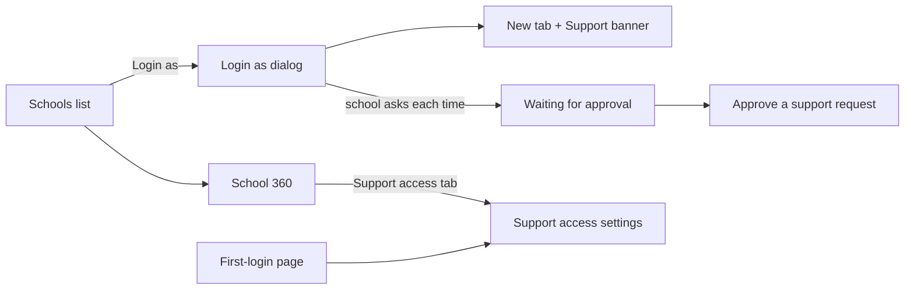

# Tenant control mockups (spec and wireframes)

Epic 99 (#3726), ticket #3777. Built from the app kit and tokens (`docs/architecture/21-ui-patterns.md`, `15-ux-principles.md`), inside the Epic 98 cockpit shell (#3765). Words come from `tenant-control-glossary.md`; no never-say word appears below.

**Status: wireframe spec, NOT frozen.** Kit-built clickable HTML, the 1440 px / 390 px screenshots, and the owner + school-staff usability test (`tenant-control-findings.md`) are owner steps still to do. Wave 5 tickets cite the section headings below by name.



Every section: 1440 px = full cockpit shell (left nav, top bar with Ctrl+K). 390 px = nav in a drawer, tables become cards, dialogs become bottom sheets, primary buttons full width.

## Schools list

```
Cockpit > Schools                                 [Search school or phone]
[Status v] [Preset v] [Last active v]            Live now: 2  (strip above)
+---------------------------------------------------------------+
| School        Status  Students Seats  Last active  [Login as] |
| Green Valley  Active  412      500    2 h ago      [Login as] |
| Sunrise       Active  120      150    3 d ago      [Login as] |
+---------------------------------------------------------------+
```

Row click opens School 360. Login as opens the dialog. 390: each row a card, Login as at the bottom.

## Login as dialog

```
Login as - Green Valley
Role     (Admin) Teacher Accountant ...        <- default Admin
Person   [PersonPicker: Rahim - active 2 h ago v]  search, limit 100
Reason   [Support request][Bug check][Setup help]  + free text (10-500 letters)
Notes    "Principal prefers calls after 4 pm"       <- school notes shown here
Code     [ _ ][ _ ][ _ ][ _ ][ _ ][ _ ]
         [ Cancel ]  [ Login as ]
```

States:

- **Default**: as above; Enter moves role, person, reason, code.
- **Blocked school**: red note "This school does not allow Biddaloy support access." and link **Emergency access**; Login as disabled.
- **No active admin**: "This school has no active admin. Invite one first." button **Invite admin**; no person list.
- **Person without a login account**: greyed row, tag "No login account", not selectable.
- **Waiting for approval**: "Waiting for approval. We told the school admins." with Time left 24 h and Cancel.

## Live sessions strip

```
Live now (2)  Green Valley - Rahim, Teacher - 42 min left [End] | Sunrise - Admin - 12 min left [End]
```

Sits above the Schools table; hidden when none. 390: horizontal scroll chips.

## School 360

```
Green Valley            [Active]   [Login as]
Overview | People | Support access | Notes | Health
```

- **Overview**: students, staff, seats, files size, last active, preset, rename, archive.
- **People**: admins first, each with Login as and a reset link for a stuck admin.
- **Support access**: current setting plus the 90-day list of Biddaloy visits.
- **Notes**: dated notes, add box.
- **Health**: queue and error counts for this school.

390: tabs become a scrollable row.

## Operations

```
Queues: 0 failed [Retry failed]   Restore lock: free [Release]
Version 1.42  Database OK  Redis OK
```

Read-only except Retry failed and Release. 390: stacked cards.

## Users

```
[Search phone or email]
Rahim  017xx  Green Valley (Teacher), Sunrise (Parent)  [Log out everywhere] [Login as v]
```

Login as chooses one school-role pair. 390: cards.

## Audit

```
[School v] [Person v] [Date range]  Tab: All | Login as visits
12 Oct 10:02  Biddaloy support (as Rahim, Teacher)  changed fee head "Tuition"
```

The Login as visits tab lists every visit: who, school, reason, length. 390: cards.

## Announcements

```
New announcement   To: [All school admins] [Only active schools v]
Title / Message / [Preview 14 schools] [Send]   (a second owner must approve)
```

## First-login page

Full page, one step, no menu.

```
Biddaloy support access
[x] Biddaloy support may log in to help this school.
    You can change this later in Settings.
                         [ Save and continue ]
```

Ticked saves Allowed; unticked saves Blocked. 390: same, full-width button.

## Support access settings

```
Settings > Biddaloy support access
( ) Allowed   ( ) Ask each time   ( ) Blocked
Last 90 days: 12 Oct, Biddaloy support, Rahim (Teacher), "Bug check", 18 min  [End] if live
Requests: 1 waiting - Biddaloy support wants to log in. [Open]
```

Only a school admin sees and changes it.

## Approve a support request

```
/support-access/requests/:id
Biddaloy support asks to log in as Rahim (Teacher).
Reason: "Fee report looks wrong"   Asked 10 min ago, valid 24 h
[ Not now ]  [ Approve ]        First answer counts.
```

Emergency write variant: "Biddaloy support asks to make changes (view only now)."

## Support banner

```
[RED] Biddaloy support is in this school as Rahim, Teacher.  Time left 42 min   [ End ]
```

Fixed on every page of the new tab. Under 10 min: "Ending soon". View-only: adds "View only". 390: two lines, End stays right.
