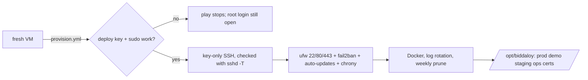

# Ansible: provision the host

One command turns a fresh Ubuntu LTS VM into the hardened Docker host.



```bash
pip install ansible                      # or: brew install ansible
cd infra/ansible
ansible-galaxy install -r requirements.yml   # installs the roles and the collections
export BIDDALOY_PROD_HOST=203.0.113.10   # the VM's public IP
# first run on a fresh VM, as the image's admin user:
ansible-playbook provision.yml -e ansible_user=root
# re-run as deploy; must end with changed=0:
ansible-playbook provision.yml | tail -3
```

Needs `~/.ssh/id_ed25519.pub` (or `-e operator_ssh_pubkey="ssh-ed25519 ..."`).

**First run: keep a root SSH session open until the second run succeeds.** The
play turns off root and password login. Before it does, it runs
`ssh -o BatchMode=yes deploy@<host> sudo -n true` from your laptop and stops if
that fails. A lockout on a BDIX VM means the provider's VNC console, so keep the
open session as a fallback anyway.

What the play sets up, and what it costs:

- **SSH.** `/etc/ssh/sshd_config.d/00-biddaloy.conf` turns off password,
  keyboard-interactive and root login. Ubuntu cloud images ship a
  `50-cloud-init.conf` that can turn password login back on; `00-` is read
  first, and the play checks `sshd -T` to prove the effective values.
- **sudo.** `deploy` has `NOPASSWD:ALL`. The `docker` group is root-equivalent
  anyway, so a password on sudo would add no real second factor. Accepted:
  the operator's SSH key is the one thing that guards root.
- **ufw.** Port 22 is `limit` (6 new connections in 30 s per IP). A script that
  opens many SSH sessions without connection sharing (`ControlMaster`) can hit it.
- **Public-port check.** Docker bypasses ufw, so compose binds everything but
  nginx to `127.0.0.1`, and the play fails if any other TCP or UDP port listens
  publicly (`ss -H -tuln`; DHCP client ports 68 and 546 are allowed). On a fresh
  VM nothing is deployed yet, so the check only means something on runs after
  `deploy.yml` (61.1).
- **Weekly prune.** Third-party images unused for 7 days go. Our own images
  (`ghcr.io/tareq89/*`) keep the newest 4 per repo, so a rollback does not need GHCR.

Secrets are not here: see `infra/secrets`. Local `.vault*` files are ignored and
the CI guard (`scripts/check-tracked-files.mjs`) fails if one is committed.
Lint: `ansible-lint infra/ansible`.
