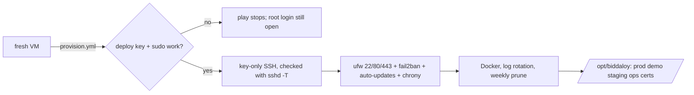

# Ansible: provision the host

One command turns a fresh Ubuntu LTS VM into the hardened Docker host.



```bash
pip install ansible                      # or: brew install ansible
cd infra/ansible
ansible-galaxy install -r requirements.yml   # installs the roles and the collections
export BIDDALOY_PROD_HOST=203.0.113.10   # the VM's public IP
# first run on a fresh VM, as the image's admin user:
ansible-playbook provision.yml -e ansible_user=root
# re-run as deploy; must end with changed=0:
ansible-playbook provision.yml | tail -3
```

Needs `~/.ssh/id_ed25519` and its `.pub`. Another key pair:
`-e operator_ssh_privkey=~/.ssh/other` (the `.pub` next to it is read). A second
operator: put every public key, one per line, in one value, for example
`-e operator_ssh_pubkey="$(cat ~/.ssh/id_ed25519.pub teammate.pub)"`. The deploy
user keeps exactly the keys in that value, so never swap it for just the new key.

**First run: keep a root SSH session open until the second run succeeds.** The
play turns off root and password login. Before it does, it adds your key to
`deploy` next to any key already there, runs
`ssh -o BatchMode=yes -o IdentitiesOnly=yes -i <operator_ssh_privkey> deploy@<host> sudo -n true`
from your laptop, and stops if that fails. Only after that probe passes does it
remove every other key from `deploy`, so a wrong key on a later run cannot lock
you out either. A lockout on a BDIX VM means the provider's VNC console, so keep the
open session as a fallback anyway.

What the play sets up, and what it costs:

- **SSH.** `/etc/ssh/sshd_config.d/00-biddaloy.conf` turns off password,
  keyboard-interactive and root login. Ubuntu cloud images ship a
  `50-cloud-init.conf` that can turn password login back on; `00-` is read
  first, and the play checks `sshd -T` to prove the effective values.
- **sudo.** `deploy` has `NOPASSWD:ALL`. The `docker` group is root-equivalent
  anyway, so a password on sudo would add no real second factor. Accepted:
  the operator's SSH key is the one thing that guards root.
- **ufw.** The SSH port (`ansible_port`, default 22) is `limit` (6 new connections in 30 s per IP). A script that
  opens many SSH sessions without connection sharing (`ControlMaster`) can hit it.
- **Public-port check.** Docker bypasses ufw, so compose binds everything but
  nginx to `127.0.0.1`, and the play fails if any other TCP or UDP port listens
  publicly (`ss -H -tuln`; DHCP client ports 68 and 546 are allowed). On a fresh
  VM nothing is deployed yet, so the check only means something on runs after
  `deploy.yml` (61.1).
- **Weekly prune.** Third-party images unused for 7 days go. Our own images
  (`ghcr.io/tareq89/*`) keep the newest 6 per repo, so a rollback does not need GHCR.
  Untagged (dangling) images go every week.

Secrets are not here: see `infra/secrets`. Local `.vault*` files are ignored and
the CI guard (`scripts/check-tracked-files.mjs`) fails if one is committed.
Lint: `ansible-lint infra/ansible`.

## Deploy a version

`deploy.yml` runs **on the VM**, never from the laptop. You run the wrapper:

```bash
# laptop: checks the sha is pushed, then ssh deploy@<vm> biddaloy-deploy ...
BIDDALOY_HOST=203.0.113.10 scripts/deploy.sh staging 3f9c2ab4e1d07a5b6c8f9e0d1a2b3c4d5e6f7a8b
BIDDALOY_HOST=203.0.113.10 scripts/deploy.sh prod    3f9c2ab4e1d07a5b6c8f9e0d1a2b3c4d5e6f7a8b
# first deploy on a fresh VM (prod has no staging ok line yet):
BIDDALOY_HOST=203.0.113.10 scripts/deploy.sh all <sha> --hotfix "first deploy"
```

On the VM, `biddaloy-deploy` checks its input, takes `/opt/biddaloy/deploy.lock`, checks out the
sha in `/opt/biddaloy/repo` and runs:

```bash
BIDDALOY_HOTFIX_REASON="<reason or empty>" \
  ansible-playbook -c local -i localhost, /opt/biddaloy/repo/infra/ansible/deploy.yml \
  -e stack=<prod|staging|demo|edge|ops> -e version=<40-hex sha> [-e skip_backup=true]
```

The hotfix reason is an environment variable, never `-e`: Ansible templates extra vars, so a
`{{ }}` in one would run as root. Pulls, backs up (prod), migrates, restarts, waits for ready,
smoke-tests, and logs to `/opt/biddaloy/<stack>/deploys.log` (full output:
`/opt/biddaloy/logs/<stack>-last-deploy.log`). On failure it brings the previous version back
(migrations are not reverted). Full flow: `docs/architecture/30-deployment-target.md`.
