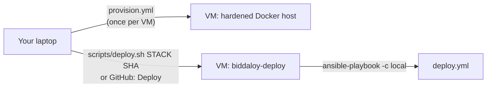

# Ansible

The full, step-by-step setup (accounts, keys, provision, secrets, first deploy,
switching VM) is one page:
**[docs/architecture/28-platform-runbook.md](../../docs/architecture/28-platform-runbook.md)**.
Start there. This file only lists what is in this folder.



| File | Run where | What it does |
| --- | --- | --- |
| `provision.yml` | your laptop, against the VM | Hardens a fresh Ubuntu LTS VM (key-only SSH, ufw, fail2ban, auto-updates), installs Docker, makes `/opt/biddaloy`, the host age key and the repo deploy key, installs the `biddaloy-*` commands and the nightly timers. Safe to re-run; the second run ends `changed=0`. |
| `deploy.yml` | **on the VM**, started by `biddaloy-deploy` | Deploys one stack (`prod`, `staging`, `demo`, `edge` or `ops`) at one 40-hex sha. Never run from the laptop. |
| `inventory/prod.yml` | both | The host, `edge_mode` (`tunnel` or `direct`), the seven hostnames, `github_deploy_pubkey_pinned`, `github_staging_pubkey_pinned`. |
| `group_vars/all.yml` | both | Non-secret settings: pinned tool versions, nightly job times, ports, locks. |
| `requirements.yml` | laptop and VM | Pinned Galaxy roles (by commit) and collections. |
| `tasks/`, `templates/` | included | Pre-flight, env files, smoke test, failure report, the cloudflared config and the nightly systemd units. |

## The two commands you need

```bash
# once per VM (from this folder). First run on a fresh VM:
export BIDDALOY_HOST=203.0.113.10
ansible-galaxy install -r requirements.yml
ansible-playbook provision.yml -e ansible_user=root
ansible-playbook provision.yml            # second run, as deploy: must end changed=0

# every release (from the repo root)
BIDDALOY_HOST=203.0.113.10 scripts/deploy.sh staging 3f9c2ab4e1d07a5b6c8f9e0d1a2b3c4d5e6f7a8b
BIDDALOY_HOST=203.0.113.10 scripts/deploy.sh prod    3f9c2ab4e1d07a5b6c8f9e0d1a2b3c4d5e6f7a8b
```

On the VM the same thing is `biddaloy-deploy <prod|staging|demo|edge|ops|all> <sha> [--hotfix "reason"] [--skip-backup]`.

## Things worth knowing before you edit

- **Keep a root SSH session open** during the first `provision.yml` run until the second
  run succeeds. The play turns off root and password login, but first tests that
  `deploy@<host>` can log in with your key and use `sudo`, and stops if not.
- **Your SSH key.** Default `~/.ssh/id_ed25519` (+ `.pub`). Another key:
  `-e operator_ssh_privkey=~/.ssh/other`. More than one operator: put every public key,
  one per line, in one value, e.g.
  `-e operator_ssh_pubkey="$(cat ~/.ssh/id_ed25519.pub teammate.pub)"`. The `deploy` user
  keeps exactly the keys in that value, so never pass only the new one.
- **GitHub's key** (can run only `biddaloy-deploy`): paste its public line into
  `github_deploy_pubkey_pinned` in `inventory/prod.yml` (it is a placeholder starting with
  `UNSET` until you do), or set `BIDDALOY_GITHUB_DEPLOY_PUBKEY` for one run.
- **GitHub's staging key** (can run only `biddaloy-staging`, for the Staging workflow): a
  second, different key. Same rules: `github_staging_pubkey_pinned` or
  `BIDDALOY_GITHUB_STAGING_PUBKEY`. The play stops if both pins hold the same key.
- **The hotfix reason** reaches `deploy.yml` in the environment variable
  `BIDDALOY_HOTFIX_REASON`, never as `-e`: Ansible templates extra vars, so a `{{ }}` in one
  would run as root.
- Staging and ops stay closed without an `access_confirmed` switch: cloudflared checks the Access token (tunnel mode) or nginx basic auth does (direct mode). The Access setup is part 4d of the guide, done by hand.
- Secrets are not here: see [`infra/secrets/README.md`](../secrets/README.md). The CI guard
  (`scripts/check-tracked-files.mjs`) fails if a `.vault*` file or a decrypted `.env` is
  committed.
- Lint: `ansible-lint infra/ansible`. Syntax check of the deploy playbook:
  `ansible-playbook -c local -i localhost, infra/ansible/deploy.yml -e stack=prod -e version=<40-hex> --syntax-check`.
