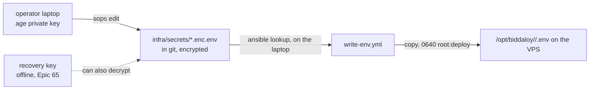

# Secrets (sops + age)

Every secret lives here **encrypted**. Only the operator's and the recovery age keys can open it.
Plaintext never gets committed (CI guard: `scripts/check-tracked-files.mjs`).



| File                                         | What                                          |
| -------------------------------------------- | --------------------------------------------- |
| `prod.enc.env`, `demo.enc.env`, `staging.enc.env` | The env for each stack                   |
| `ops.enc.env`                                | Ops stack: `BESZEL_KEY` (`sops infra/secrets/ops.enc.env`). `OPS_DOMAIN` and `STAGING_DOMAIN` go in `prod.enc.env`: prod nginx reads them |
| `origin-ca.enc.pem`, `origin-ca-key.enc.pem` | Cloudflare Origin CA cert and key (D21)       |
| `*.example.env`                              | Plaintext key lists, empty values, committed  |

Staging has no OAuth or SMS keys on purpose (D25); its Turnstile key is
Cloudflare's public always-pass test key.

## One-time setup

Install `sops` (3.9 or newer, for `--filename-override`) and `age` (`brew install sops age`).

1. **Operator key** (on your laptop):
   ```bash
   mkdir -p ~/.config/sops/age
   age-keygen -o ~/.config/sops/age/keys.txt   # prints "Public key: age1..."
   export SOPS_AGE_KEY_FILE=~/.config/sops/age/keys.txt
   ```
2. **Recovery key**: run `age-keygen` once on a *different* machine. Store the
   private half as Epic 65 (#1737) says. Never on a laptop that also holds the
   operator key.
3. Put both **public** keys (`age1...`) into `.sops.yaml`, replacing the two
   `REPLACE_WITH_...` placeholders. Commit that.
4. Create each file with the sops editor, so no plaintext copy touches disk:
   ```bash
   sops infra/secrets/prod.enc.env     # opens $EDITOR on a new file; paste the keys from prod.example.env and fill values
   ```
   Make each random value with `openssl rand -hex 32`. Hex only: compose
   expands `$` in unquoted `.env` values, and `POSTGRES_PASSWORD` goes into
   `DATABASE_URL` without URL-encoding, so `@`, `/`, `:` and `$` break it.
   Never fill the values into `prod.example.env` itself: the CI guard fails on
   any value there.
   Repeat for `demo` and `staging`. The certs are whole files, so they need a
   short-lived temp file (`umask 077`, then delete it; on a laptop disk
   deletion is best effort, not a guarantee):
   ```bash
   umask 077; t=$(mktemp)              # paste the PEM into $t, then:
   sops --encrypt --filename-override infra/secrets/origin-ca.enc.pem \
     --input-type binary --output-type binary "$t" > infra/secrets/origin-ca.enc.pem
   rm -f "$t"
   ```
   Same for `origin-ca-key.enc.pem`.
5. Check **both** keys work. Run the recovery check on a clean machine, or with
   an empty home so nothing is cached, then lock that key away:
   ```bash
   sops -d infra/secrets/prod.enc.env >/dev/null && echo laptop ok
   HOME=$(mktemp -d) SOPS_AGE_KEY_FILE=/Volumes/usb/recovery.txt sops -d infra/secrets/prod.enc.env >/dev/null && echo recovery ok
   ```

CI guard: `scripts/check-tracked-files.mjs` checks content, not just names.

| Tracked file | Must be |
| --- | --- |
| `infra/secrets/*.enc.env` | sops output: every value line is `KEY=ENC[AES256_GCM,...`, every comment is `#ENC[AES256_GCM,...`, and only the `sops_*` metadata keys sops writes (version, mac, lastmodified, unencrypted_suffix, age recipients). One plaintext line or comment added in a normal editor fails it. |
| `infra/secrets/*.enc.pem` | sops JSON: `data` starts with `ENC[`, and a `sops` block. |
| any `*.example.env` | every `KEY=` empty, and no commented-out `# KEY=value`. Only staging's Turnstile test key is allowed. |
| any other `*.env`, `*.env.bak` / `.txt` / `~`, `*.dotenv`, `.envrc` | not tracked at all (a decrypted `sops -d ... > prod.env` copy). `*.example.env` is fine. |
| `infra/ansible/.vault*` | not tracked at all. |
| anything | no age private key, no PEM private key, and no line like `POSTGRES_PASSWORD=<12+ chars>` for the main secret keys unless it is `ENC[...]` or a test value. |

## Everyday

| Do                    | Command                                                |
| --------------------- | ------------------------------------------------------ |
| Edit                  | `sops infra/secrets/prod.enc.env`                      |
| View                  | `sops -d infra/secrets/prod.enc.env`                   |
| Change recipients     | edit `.sops.yaml`, then `sops updatekeys infra/secrets/<file>` for each file |
| Push to the server    | a full `deploy.yml` of the running version (rotation steps: `docs/architecture/12-operations.md` section 8). `--tags env` only rewrites `.env` and restarts nothing |

Add a new key: add it to the matching `*.example.env` too, so the examples stay
the full list.

## Laptop lost

1. Decrypt with the recovery key (step 5 above, on a clean machine).
2. Make a new operator key, update `.sops.yaml`, run `sops updatekeys` on every file.
3. Assume the old key is stolen: **rotate every secret** (section 8 of
   `12-operations.md`), then commit the re-encrypted files.
